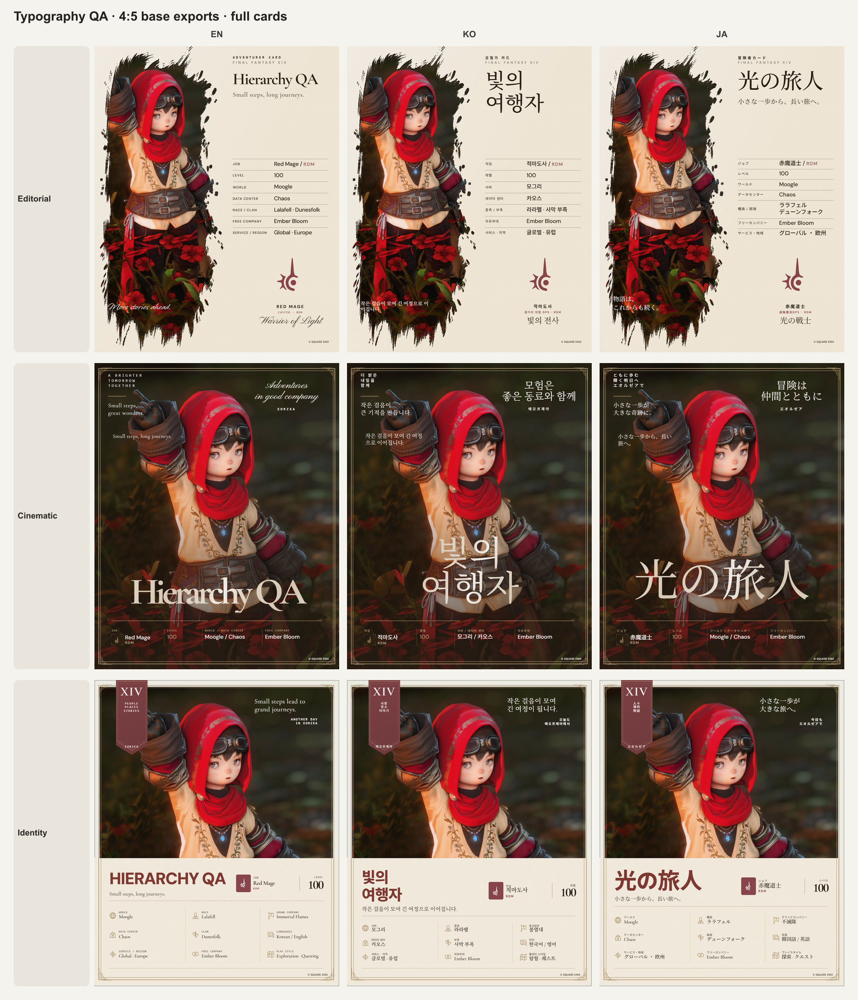
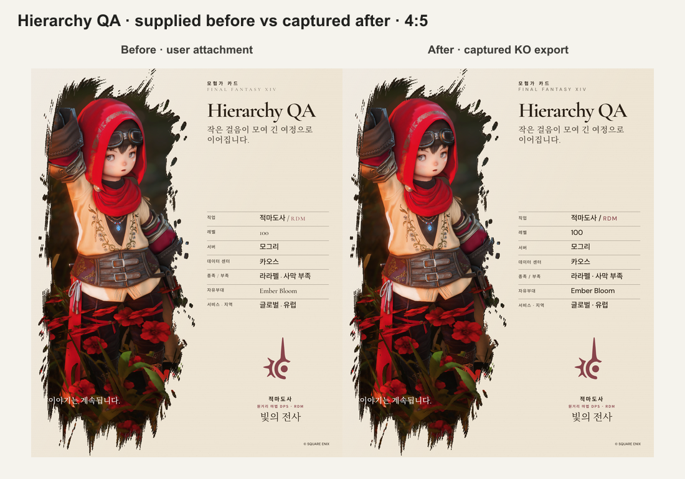

# 카드 내용 서체·크기 다국어 교정

2026-10-12 사용자 첨부 `Hierarchy-QA-4x5-1x.png`의 정보값 서체·크기 불일치 지적에 따라 세 카드의 KO/EN/JA를 확인하고 수정했다. 앱 테마 기준 `DESIGN.md`와 설치 Stone 원본은 변경하지 않았다. 카드별 작품 구도·사진·장식·이름 맞춤·단일 preview/export 렌더 경로·데이터 저장을 유지한다.

## 확인한 문제와 수정

1. C2/E2 정보용 KO/JA sans stack의 첫 face가 Latin-only Cormorant였다. 같은 정보값에서도 한글·일본어는 Noto Sans, 숫자·영문은 Cormorant로 갈려 크기와 종류가 달라 보였다. DM Sans를 앞에 두고 등록된 Noto Sans KR/JP를 연결했다.
2. Latin non-display 역할은 CSS 변수를 내보내지 않아, 영문 정보·레이블·보조 문구의 family가 이름 또는 선택 preset의 fallback에 의존했다. 선언된 master 역할별 family를 모든 script에 명시한다. 정보 역할은 weight 500과 tracking/leading도 명시하고, 다른 Latin 역할의 기존 metric selector는 유지한다.
3. 시네마틱의 compact 정보 영역은 직업에 별도 serif, 레벨에 별도 family와 1.18배 크기를 사용했다. 직업·레벨·서버/DC·자유부대의 primary value를 한 정보 tier로 맞췄다. 레벨의 색과 lining/tabular numerals, 작은 직업 약어는 유지한다.
4. 에디토리얼 정보표의 직업·서비스도 같은 information 역할로 정리하고 레벨에 lining/tabular numerals를 적용했다. JA 종족·부족만 1.5cqi로 줄인 예외를 제거했다. 세로/정사각형은 두 원문을 각각 한 줄로 배치하고 해당 행에 두 배의 flex grow를 배정한다. JA 행의 안쪽 여백은 `.45cqi`로 조정하며 전체 표의 위치·영역은 유지한다. 두 줄에서 구분용 점은 숨기고 줄바꿈으로 구분한다. 다른 비율·언어의 구분 기호는 유지한다.

## 역할별 기준

| 정보 영역 | 영문 | 한글 | 일본어 | 굵기 |
| --- | --- | --- | --- | ---: |
| 시네마틱 compact 값 | DM Sans | Noto Sans KR, Latin은 DM Sans | Noto Sans JP, Latin은 DM Sans | 500 |
| 에디토리얼 정보표 값 | DM Sans | Noto Sans KR, Latin은 DM Sans | Noto Sans JP, Latin은 DM Sans | 500 |
| 모험가 기록 record 값 | Cormorant | Noto Serif KR, Latin은 Cormorant | Noto Serif JP, Latin은 Cormorant | 500 |

서로 다른 언어의 glyph를 물리적으로 한 face로 바꾼다는 의미는 아니다. 같은 정보 tier 안에서 sans/serif 종류와 크기·굵기를 일관되게 사용한다. 이름·소개·레이블·작은 코드·장식 문구는 각각의 위계를 유지하고, 기록 카드의 큰 Job/Level 표시도 일반 record 값과 구분한다. 긴 이름의 optical fit과 48자 FC의 실측 축소는 유지한다.

| 비율 | 시네마틱 정보 cqi | 에디토리얼 정보 cqi | 모험가 기록 값 cqi |
| --- | ---: | ---: | ---: |
| 1:1 | 1.75 | 2.28 | 1.65 |
| 4:5 | 2.25 | 2.28 | 2.00 |
| 3:4 | 2.15 | 2.28 | 1.88 |
| 9:16 | 1.52 | 1.65 | 1.83 |
| 16:9 | 1.35 | 1.12 | 1.00 |

이 값은 카드의 CSS container 기준이다. 실제 article border와 container 너비 때문에 기록 카드 DOM 값은 약 1.64/1.99/1.87/1.82/1.00cqi로 측정됐다. 서로 다른 구도의 세 카드를 같은 절대 크기로 평탄화하지 않았다. 정상 길이의 에디토리얼 일곱 정보값은 각 비율에서 정확히 같은 computed size/weight를 확인했다.

## 수정·검증 순서와 결과

- 수정 전: 같은 이름 `Hierarchy QA`로 3 masters × KO/EN/JA 9조건의 DOM family·크기·굵기와 화면을 저장했다. `before-9.json`, `before-*.jpg`.
- JA 행 첫 접근은 nowrap span 두 개가 한 줄에 붙어 4:5/1:1/3:4의 오른쪽으로 넘쳤다. 이 3회는 `lineage-first-failed-runs.json`에 남겨 실패로 기록했다. grid 두 줄·행 여백 수정 후 다시 출력·확인하고 다음 카드로 진행했다.
- 기본 실제 파일 45개: 3 masters × 3 locales × 5 ratios, PNG 1×. 이름은 KO `빛의 여행자`, EN `Hierarchy QA`, JA `光の旅人`, 자유부대는 `Ember Bloom`이다.
- 추가 20개: Editorial FC48 KO/EN/JA × 5 ratios 15개, JA FC48 4:5 WebP 4× 1개, C2 KO/E2 EN/I3 JA 4:5 WebP 2× 3개, 첨부와 같은 이름의 E2 KO 4:5 PNG 1× 1개. 총 65회 완료.
- 독립 파일 검사: 65/65 원본 전체 Sharp decode, signature·MIME·치수·bytes·SHA-256·sidecar·manifest·화면의 실제 bitmap 치수·출력 크기 계산 일치. 4× 결과는 4195×5243, 21,994,385 pixels로 22MP/8192 edge 상한 안이다. manifest의 첫 실패 3개는 성공 65개에서 제외했다.
- Editorial 기본 15개·FC48 15개에서 각 정보값 box가 자기 행 안에 있으며 FC 측정 준비가 완료됨을 확인했다. C2/I3의 첫 출력 기록에는 행별 bounds가 없어 DOM 역할 일치와 선택한 원본의 시각 확인으로 구분했다.
- 수집 코드 제거 후 일반 빌드에서 390px/320px × 3 masters × 3 locales × 5 ratios의 90조건을 추가 실측했다. 검사한 이름·직업·레벨·world/DC·종족·부족·FC·origin box가 카드 안에 있고 모든 optical marker가 준비 완료였다. 이 검사는 카드 포함 판정이며 행별 포함 판정과 구분한다.
- 같은 Latin 이름의 4:5 언어 비교 9조건을 일반 빌드에서 확인했다. 일반 빌드 KO `Hierarchy QA` PNG 1× 결과는 1080×1350 완료, console warning/error 없음.
- 역할별 family와 정보 weight를 3 masters × 3 locales × 5 presets에서 확인하는 rendered-style 회귀 테스트를 추가했다. 일반 빌드·타입·전체 ESLint 통과. 전체 테스트 260개 통과, 기존 archive 29개 skip, 실패 0개. 변경 파일의 whitespace diff 검사 통과.

`tmp/typography-validation-2026-10-12/browser-runs.json`, `mobile-font-runs.json`, `same-name-font-controls.json`, `normal-export-smoke.json`, `final-*.log`, `final-file-audit.md/.json`, `independent-review.md`에 실제 근거를 보관한다. 검수용 endpoint/환경 플래그/타이머는 제품 src/out/dist에 남아 있지 않다. 설치 Stone SHA-256은 `E25912D9A98152C90EC17352DBE22A6573928522063C807DDD3CCDA906C55F92`로 유지됐다.

## 비교 이미지

두 번째 비교는 첨부 파일과 현재 KO 출력 두 파일의 시각 비교다. 이전 첨부의 모든 데이터·preset·crop이 현재와 동일하다고 증명한 것은 아니다. 동일 조건 9개의 언어 비교와 파일 무결성 검사를 별도로 사용했다. DOM family는 computed CSS stack이며 모든 glyph의 실제 platform face를 개별 추적했다는 뜻은 아니다. PNG/WebP의 pixel-identical rasterization이나 실제 다른 OS/browser 통과도 주장하지 않는다. 사용자 origin 4322 데이터는 변경하지 않았고, 모든 입력·보관 테스트는 별도 4324 QA origin에서 했다.
