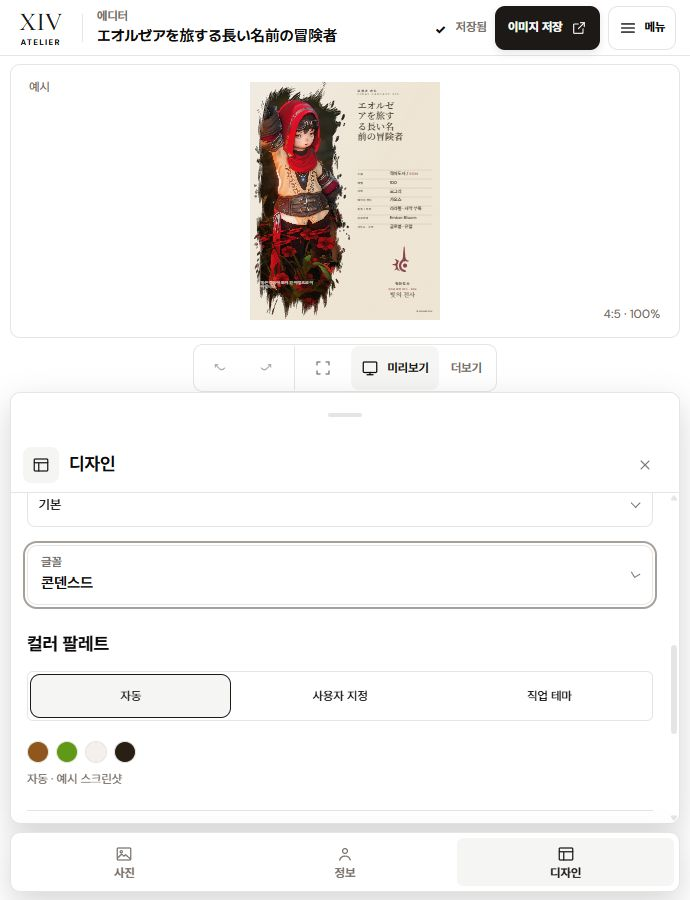

# 디자인 패널 팔레트·글꼴·펼침 표시 수정

사용자 스크린샷에 나타난 팔레트 변형, 글꼴 설정의 실험 옵션 오인, 중복된 펼침 표시를 수정했다. 앱 기준은 루트 `DESIGN.md`와 설치된 Stone 테마다.

## 수정

- 자동 팔레트의 `flex: 1` 때문에 72.25×22px로 늘어나던 색상을 22×22px 원형으로 고정했다. 직업 팔레트도 같은 크기로 유지한다.
- `글꼴 / Font / フォント`를 현재 선택값이 보이는 일반 디자인 설정으로 배치했다. 기본은 접힌 상태이며 클릭하면 선택지가 열린다. B/C 실험 레이아웃은 효과 아래로 이동하고 전용 레이블을 사용한다.
- 글꼴 헤더에 중복되던 명시적 표시를 제거했다. 디자인 패널의 펼침 표시와 카드 문구 선택은 같은 CSS chevron 기하를 사용한다. 선택 여부는 체크 기호로 유지한다.
- 카드 문구 선택은 native select와 키보드 동작을 유지한다. 실물 검사에서 발견한 화살표의 별도 행 생성은 label 1행, select와 화살표 2행으로 수정하고 다시 빌드·검증했다.

이번 변경은 패널 UI 범위다. 카드 마스터의 서체 역할별 매핑과 출력 렌더러는 변경하지 않았다. 글꼴 선택 상태 확인은 카드 모든 역할의 서체가 변경된다는 검증을 뜻하지 않는다.

독립 검토에서 기본 펼침 상태가 팔레트를 아래로 밀어내는 문제가 지적돼 접힌 기본 상태로 조정하고 다시 빌드·실물 확인했다. 화살표 통일은 디자인 패널의 펼침과 카드 문구 선택 범위다. 헤더의 native 언어 선택과 정보 탭의 검색형 선택 위젯까지 교체한 작업은 아니다.

독립 검토의 별도 발견: 기존 B/C 변형에서는 마스터 카드 버튼이 모두 unpressed가 되고 활성 변형 표시가 하단 실험 레이아웃 안에만 남는다. 디자인 탭 재진입 시 접히면 선택 표시의 발견성이 약해진다. 선택·데이터 오류는 확인되지 않았으며, 이 작업에서는 기존 변형 선택 의미를 변경하지 않았다.

## 실제 검증

별도 origin `127.0.0.1:4324`에서 같은 긴 일본어 이름과 기존 카드 데이터로 확인했다. 사용자 origin `4322`의 데이터는 조작하지 않았다.

| 범위 | 결과 |
| --- | --- |
| 1440 / 901 / 900 / 690 / 390 / 320px | 자동 팔레트 모두 22×22px, 문서 가로 넘침 없음 |
| KO / EN / JA × light / dark × 1440 / 320px | 원형 팔레트 유지, 문서 가로 넘침 없음, 글꼴이 실험 레이아웃 밖에 위치 |
| 320px 직업 팔레트 | 두 색상 모두 22×22px |
| 사용자 지정 팔레트 | 색상 입력 32×32px, 기존 48px 레이블 조작 행 유지 |
| 글꼴 설정 | 선택 표시 변경 및 Enter로 펼침·접힘 확인 |
| 카드 문구 | native appearance 제거, 44px select 안의 같은 행에 화살표 배치 |
| 정적 검사 | 전체 ESLint·타입 검사·프로덕션 빌드 성공, 테스트 265 통과 / archive 29 제외 / 실패 0 |
| 테마 원본 | SHA-256 `E25912D9A98152C90EC17352DBE22A6573928522063C807DDD3CCDA906C55F92` 유지 |

측정 원본은 `tmp/design-panel-validation-2026-10-12/geometry.json`, `locale-light.json`, `locale-dark.json`에 있다. 현재 작업 파일의 `git diff --check`는 통과했다. 전체 작업 트리 검사에는 기존 release HTML의 trailing whitespace가 남아 있다.

