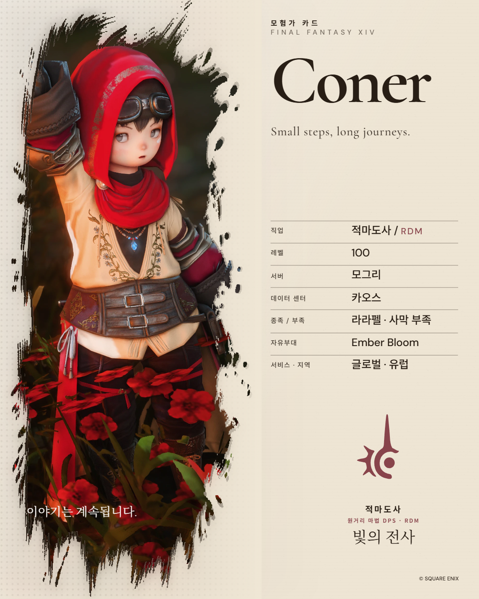

# 에디토리얼 · 사진 기반 에어브러시와 하프톤

이 문서는 첫 적용의 기록이다. 사용자의 후속 참고 이미지와 서체·레이어 요청에 따른 현재 구성은 [서체 편집과 인쇄 질감 레이어](./TYPOGRAPHY_AND_PRINT_LAYERS_2026-10-12.md)를 따른다.

2026-10-12 사용자 제안에 따라 같은 사진을 선명한 전면과 은은한 배경으로 사용했다. 기존 작업은 먼저 `62db198`로 origin/main에 푸시했고, 이 후속 디자인 변경은 별도의 로컬 검토 상태다.

## 표현

- 전면 사진의 브러시 모양, 위치, 확대·회전·색 조절을 보존한다.
- 마스크 가장자리 뒤에는 같은 사진의 복사본을 약간 확장하고 흐리게 배치한다. 안쪽 노드에 기존 clip을 적용하고 바깥 노드에 blur를 적용해 번짐이 잘리지 않도록 한다.
- 배경에는 같은 사진을 카드 크기로 펼쳐 7% 불투명도, 3cqi blur, .65 채도로 처리한다. 정보 열 시작점에서는 마스크 알파가 .2로 줄어들고 이후 투명해져 종이 위 글자를 읽을 수 있게 한다.
- 사진 주변에 낮은 불투명도의 하프톤 점을 추가하고 종이색으로 자연스럽게 사라지게 한다. 9:16 배경 사진은 상단 42%에만 놓는다.
- 사진이 없으면 새 장식 레이어를 만들지 않는다. 장식 사진 두 장은 빈 alt와 aria-hidden을 사용하고 기존 원본 사진의 설명은 보존한다.

사진은 새 파일로 가공하지 않는다. 세 표현이 동일한 이미지 URL과 기존 사진 조절 CSS 변수를 공유한다. 앱 테마, 저장 스키마, 원본 SVG 브러시 경로, 카드 출력 경로는 그대로다. 추가 애니메이션은 없다.

## 검증

| 검사 | 결과 |
| --- | --- |
| 동일 데이터 전후 PNG | 원본 5비율과 적용 후 5비율 비교. 각 비율의 지정된 불투명 인물 패치에서 변경 채널 0 |
| 최종 출력 | PNG 2× 5비율, PNG 1× 미리보기, WebP 2×, 상한 적용 WebP 4×: 8개 모두 디코딩·형식·크기·바이트·SHA 기록 일치 |
| 최대 출력 | 4,195×5,243 = 21,994,385픽셀, 기존 상한 이내 |
| 다국어 DOM | KO/EN/JA × 5비율 = 15조건. 같은 이미지 3장, 원본 설명 1개, 장식 설명 0개, 로딩·clip 참조·조절 변수 일치 |
| 사진 조절 | 위치·확대·회전·밝기·대비·채도·노출 8종의 키보드 변경과 Undo. 세 표현이 함께 변경되고 원래 값으로 복원 |
| 사진 없음 | SSR 회귀 검사에서 장식 그룹 부재와 기존 기본 렌더 유지 |
| 통합 검사 | 테스트 279개 통과·실패 0, 역사적 아카이브 29개 skip. lint·typecheck·프로덕션 빌드 통과 |

픽셀 일치는 기록한 인물 패치에 대한 결과이며 카드 전체나 모든 사용자 사진의 픽셀이 같다는 뜻이 아니다. 원본 사진의 비율별 crop을 보존했으므로 세로 스토리 등에서 필요한 사진 위치 조절은 기존 편집 기능을 따른다. 출력 소요 시간은 개별 관측값이며 FPS나 메모리 성능 개선을 주장하지 않는다.

원시 근거는 `tmp/editorial-airbrush-2026-10-12/`의 `export-audit.json`, `dom-matrix.json`, `photo-controls.json`에 보관한다. 실제 출력 Blob을 로컬에 기록하는 임시 검수 분기는 제거했다. `src/app/export/page.tsx` SHA-256은 기존 `DA94AABCAFCA1F7A67DAEFFB726668CD530C349AB578C790585A0954613AC042`와 일치하며, 정상 src/out/dist에는 해당 검수 코드가 없다. 미리보기 서버도 일반 서버로 복원했다.

## 실제 출력

[변경 전](./product-previews/editorial-airbrush-2026-10-12/before-4x5.png) · [변경 후](./product-previews/editorial-airbrush-2026-10-12/after-4x5.png)

아래는 공개 샘플 사진으로 생성한 실제 PNG다. 사용자가 업로드하는 사진에도 같은 구성과 조절 값이 적용된다.

