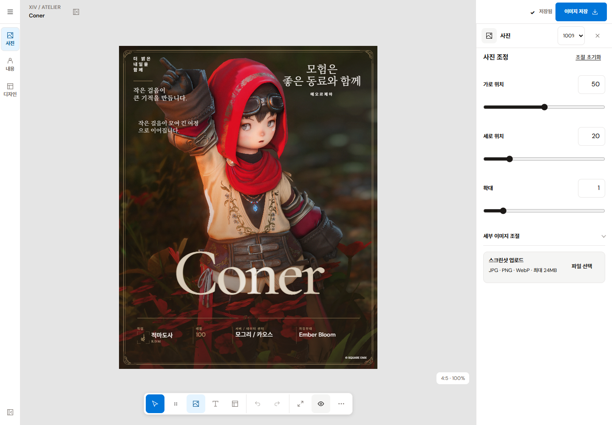
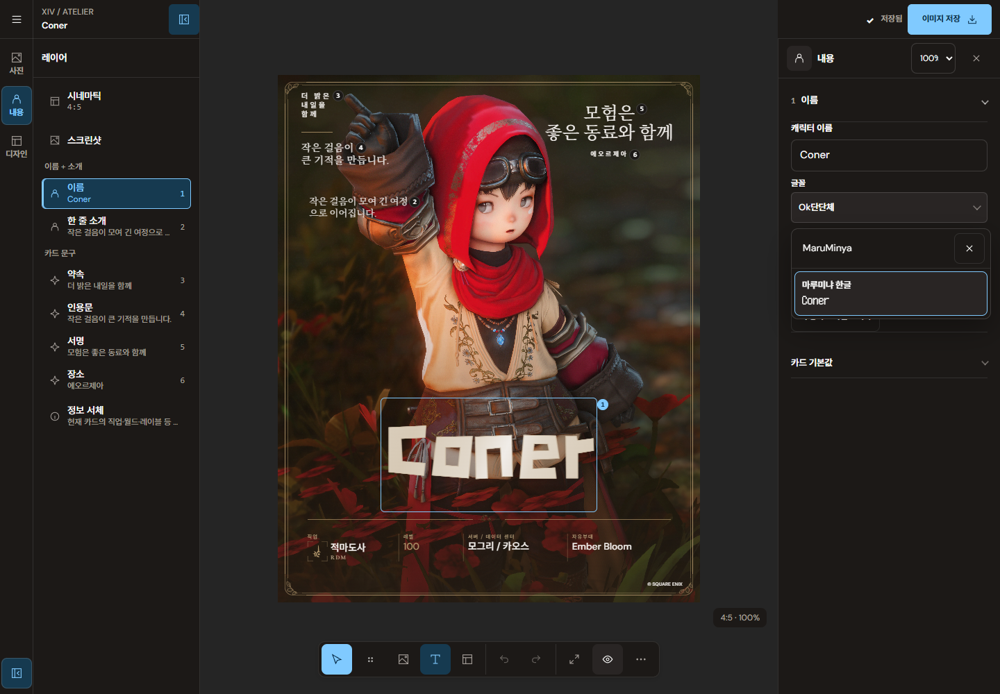

# 실제 Figma 제품 화면 대조와 편집기 구조 교정

사용자가 첨부한 Figma 제품 UI와 이전 구현을 대조했다. 이전 구현은 독립 도구 레일이 빠져 있었고, 항목 패널을 접을 수 없었으며, 캔버스 위 업로드 줄과 긴 라벨·확대 컨트롤이 들어간 도구막대가 참조 화면의 기하와 달랐다. 이 문서는 그 차이를 교정한 후속 구현 기록이다. 현재 계약은 [루트 DESIGN.md](../../../DESIGN.md)다.

## 적용

- 데스크톱은 **48px 도구 레일 + 240px 레이어 패널 + 유동 캔버스 + 300–320px 속성 패널**로 구성한다. 레일은 사진·내용·디자인의 실제 작업을 제공한다.
- 문서 헤더에 패널 접기/열기 버튼을 추가했다. 패널을 접으면 레일을 유지하면서 캔버스가 넓어진다. 레이어 제목의 중복, 카드처럼 감싸진 프레임 항목, 선택 체크의 별도 공간을 제거하고 평평한 목록으로 정돈했다.
- 캔버스 위의 예시·업로드 줄을 제거했다. 사진 업로드는 기존 사진 도구와 추가 도구에서 실행한다.
- 데스크톱 하단 도구막대는 44px 아이콘 조작 영역, 18px 아이콘, 얇은 그룹 경계와 작은 그림자로 구성한다. 긴 라벨과 확대 컨트롤은 도구막대 밖으로 옮겼다. 확대율 선택은 속성 헤더에 있고, 추가 확대·축소·업로드·보관·안전영역·초기화는 추가 도구에서 제공한다.
- 작업 표면과 선택 표시를 편집기 전용 토큰으로 정의했다. 공통 Stone 토큰은 유지하고 편집기 선택·포커스·주 도구에는 파란 역할을 사용한다. 직접 계산한 대비는 light 주 도구 4.62:1, light 선택 글자 6.35:1, dark 주 도구 8.08:1, dark 선택 글자 6.73:1이다.
- 레일의 작업 순번은 제거하고 카드 텍스트의 편집 번호만 유지했다. 글꼴 선택은 속성 패널 전체 폭을 사용해 기본 글꼴의 실제 이름이 잘리지 않게 했고, 크기 조정은 그 아래의 짧은 행으로 배치했다.
- 901–1180px은 레일과 모달 레이어 서랍을 사용하며, 900px 이하는 기존 키보드 대응 속성 시트와 작업 도크로 전환한다. 모달 열기 버튼을 공유 참조로 기록해 터치에서 버튼에 자동 포커스가 생기지 않아도 닫은 뒤 호출 버튼으로 복귀한다.

패널 열림과 접힘은 `EditorChromeProvider`의 세션 상태다. 이 상태는 카드 초안이나 출력 데이터에 직렬화하지 않는다. 신규 편집기 색상 변수는 카드 출력 루트에서 차단하며 카드 텍스트·사진·내보내기 렌더는 기존 경로를 사용한다.

## 검증

초기 구조 교정의 TypeScript·ESLint·프로덕션 빌드와 통합 테스트(361개 통과, 기존 아카이브 29개 건너뜀)가 통과했다. 초기 브라우저 반응형·접기/서랍 검사는 15/15, 마지막 헤더·폰트 이름 잘림 교정 검사는 8/8이었다.

이후 사용자의 폰트·일관성 검수 요청에 따라 접힌 헤더 표면도 48px 레일에 맞췄다. 문서 이름과 다시 열기 조작은 인접한 캔버스 헤더에서 계속 보인다. 템플릿·비율·모드·텍스트 항목·글꼴 등 편집기의 선택 표시는 같은 파란 토큰으로 통일했고 배경·경계·글자 전환은 기존 모션 토큰과 reduced-motion을 따른다.

최종 통합 검증은 **373개 테스트 통과 / 기존 아카이브 29개 건너뜀, 브라우저 29/29 통과**, TypeScript·ESLint·프로덕션 빌드 통과다. 라이선스·시각적 글꼴 선택·실제 이미지 저장을 포함한 상세 결과는 [폰트 업그레이드 기록](./REQUESTED_FONTS_2026-10-13.md)에 있다. 별도 QA 서버/브라우저는 정리했고 사용자 4328 미리보기와 저장 데이터를 보존했다.

