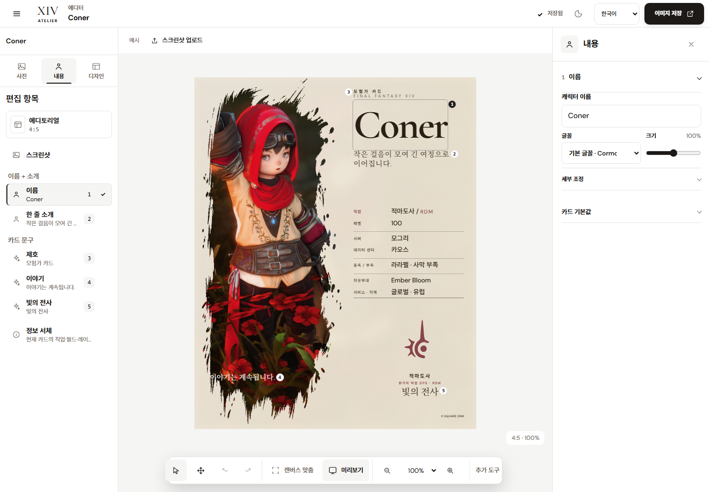
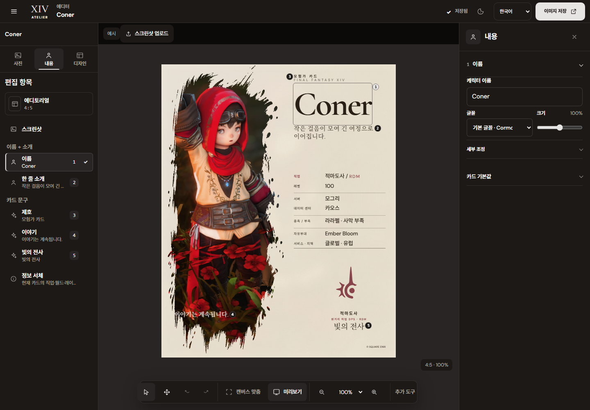
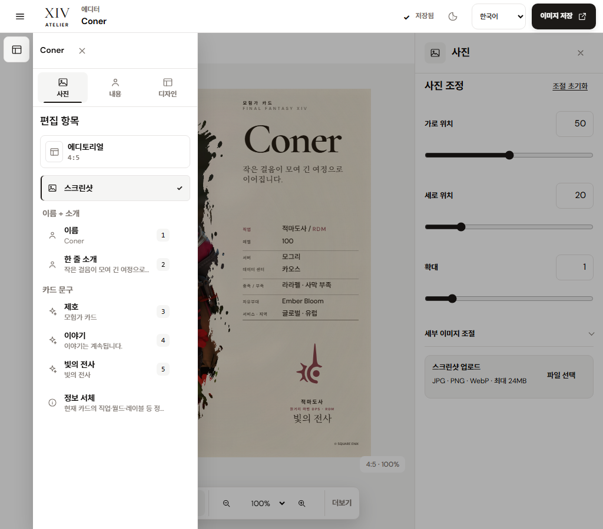
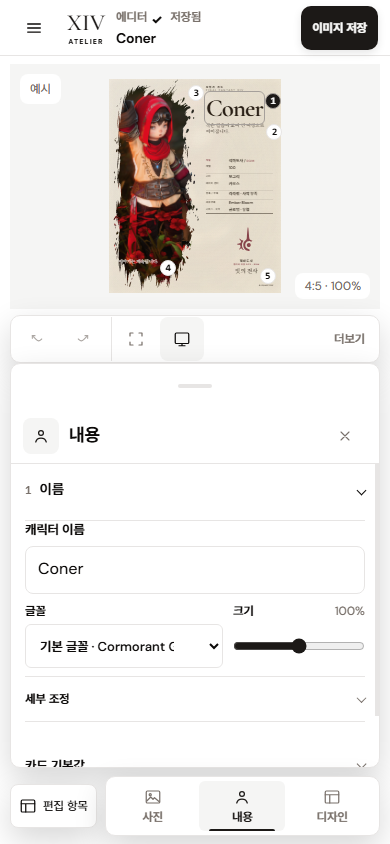

# 편집기 레이어 내비게이터와 반응형 검증

2026-10-13 사용자가 요청한 편집기 재구성은 사용자가 첨부한 Figma 제품 UI와 프로젝트의 Figma 화면을 참고해 실제 카드 도구에 적용했다. 데스크톱의 왼쪽 탐색기, 카드 스테이지, 오른쪽 인스펙터 구조와 모바일 카드 우선 흐름을 반영하며, 현재 앱 색상·글꼴·밀도·반응형 규칙을 루트 [DESIGN.md](../../../DESIGN.md)에 갱신했다.

참고 화면은 [Figma Desktop / Editor · 75:1851](https://www.figma.com/design/MqkXWfirWgjyyRbqGZjacF?node-id=75-1851)와 [Figma Mobile / Editor canvas · 69:1073](https://www.figma.com/design/MqkXWfirWgjyyRbqGZjacF?node-id=69-1073)다. 데스크톱 화면은 왼쪽 도구, 중앙 카드 미리보기, 오른쪽 속성 편집을 나눈다. 모바일 화면은 카드가 먼저 보이고 사진·내용·디자인 도구가 하단에 온다.

`npx getdesign@latest add figma`를 실제 실행해 설치한 [`figma/DESIGN.md`](../../../figma/DESIGN.md)는 Figma 공식 제품 UI 명세가 아닌 VoltAgent의 마케팅 사이트 분석이다. 실행 버전은 `getdesign@0.6.26`이며 런타임 의존성은 추가하지 않았다. 단색 UI·얇은 구획선·절제된 그림자·일관된 간격·주 행동 위계는 제품 계약에 반영했다. 86px 디스플레이 제목, 파스텔 섹션 블록, pill CTA는 밀도 높은 편집기 조작부에 적용하지 않았다. 생성 파일은 원본과 MIT 라이선스를 보존했고 출처·hash·범위를 [`figma/README.md`](../../../figma/README.md)에 기록했다.

## 구현 구조

데스크톱은 **240px 탐색기 · 가변 캔버스 · 300–320px 인스펙터** 3열로 배치한다. 1440×1000 QA 캡처에서 각 열은 240px, 880px, 320px였다. 카드는 현재 선택 비율을 유지하며 중앙 스테이지 안에서 맞춘다.

901–1180px에서는 왼쪽 탐색기를 56px 레일로 접고, 열기 동작으로 280px 탐색기 드로어를 캔버스 앞에 연다. 1024×900 캡처에서 드로어는 헤더 아래부터 화면 하단까지 열렸고, 오른쪽 인스펙터와 카드 스테이지는 유지됐다.

900px 이하에서는 카드 스테이지, 60px 하단 도크, 인스펙터 시트로 편집 흐름을 바꾼다. 탐색기는 필요할 때 화면 왼쪽에 최대 288px 또는 화면 폭의 85%까지 여는 모달 드로어다. 390×844에서는 카드 스테이지가 도크와 시트 위에 남고, 844×390 가로 화면에서도 탐색기 목록을 스크롤해 닫기 헤더에 접근할 수 있다.

[EditorLayerPanel](../../../src/components/editor/editor-layer-panel.tsx)은 등록된 카드 대상을 표시한다. 선택한 카드 템플릿과 비율은 디자인 도구를 여는 카드 프레임 항목으로, 실제 스크린샷은 사진 도구로 연결한다. 이름·소개와 편집 가능한 카드 문구는 `getCardTextItems()`에서 온 항목만 보여주며 `getIndividualTypographyOrdinal()`의 기존 순번을 사용한다. 정보 서체는 개별 필드마다 반복하지 않고 하나의 그룹 항목으로 둔다. 그 항목은 현재 선택된 정보 대상을 유지하고, 첫 진입에는 직업 대상을 기준으로 기존 인스펙터를 연다. 임의의 자유형 레이어를 새로 만들거나 순서를 바꾸는 기능은 제공하지 않는다.

현재 카드 렌더러와 편집기 경계는 유지한다. [editor-workspace.tsx](../../../src/components/editor/editor-workspace.tsx)의 실제 `CardTextItem` 선택 상태가 탐색기와 인스펙터를 연결한다. 카드 위 텍스트 대상은 [card-text-overlay.tsx](../../../src/components/editor/text-editor/card-text-overlay.tsx)에서 선택하며, 오버레이는 내보내기 카드 서브트리 밖에서 렌더된다.

## 입력, 사진 자르기와 포커스 경계

캔버스 이동·확대와 카드 사진 조정은 서로 다른 작업이다. QA에서 캔버스 휠과 줌 컨트롤은 미리보기 배율만 바꿨고, 이동 모드의 드래그는 캔버스를 움직이면서 사진 자르기 값을 유지했다. 내용 모드에서 카드 위를 드래그해도 사진 조정값은 바뀌지 않았다. 사진 도구에서의 드래그만 이미지 위치를 조정했다.

탐색기 드로어는 열릴 때 닫기 버튼에 포커스를 놓고 Tab 이동을 내부에 가둔다. Escape는 드로어를 닫고 열기 버튼으로 포커스를 돌려준다. 탐색기에서 레이어를 고르면 모바일 드로어를 닫고 정보 인스펙터로 이동한다. 헤더와 뒤쪽 편집 영역은 모달 탐색 중 inert 처리해 조작을 막는다. 버튼의 선택 상태는 `aria-pressed`와 체크·선택 표시로 함께 전달된다.

모달 탐색기에 `data-editor-shortcuts-disabled` 경계를 적용해 서랍 안에서 실행 취소·확대·축소·맞춤 키를 눌러도 배경 캔버스 상태가 바뀌지 않게 했다. Escape와 서랍의 자체 키보드 탐색은 유지한다.

## 검증 결과

브라우저 캡처와 상호작용 검증은 Chrome 154, 한국어, 라이트 테마, Editorial 4:5 Coner 샘플을 기본 fixture로 사용했다. 뷰포트 검증은 320×740, 390×844, 901×900, 1024×900, 1181×900, 1280×720, 1440×1000에 더해 844×390 가로 화면, 1024×600 낮은 태블릿 높이, 390×390 가상 키보드 높이를 포함한다.

- `guideline-final-v3`: 14개 레이아웃·타이포그래피·도구 검사가 통과했고 실패는 0건이었다. 320px 최소 폭과 44px 도구 조작 영역, 901px과 1440px의 인스펙터 및 탐색기 글자 크기, 가로 화면의 드로어 스크롤, 다크 테마 캡처를 포함한다.
- 최신 상호작용 프로브: 캔버스 줌·맞춤·팬과 사진 조정 구분 7/7 통과, 태블릿·모바일 드로어 및 포커스 복귀 10/10 통과, 이름 수정·undo·redo·새로고침 복원 4/4 통과.
- 최종 모달 단축키 프로브: 1024px·390px 서랍 안에서 Ctrl+Z와 +/−/0를 눌러도 이름·줌이 유지됐고 Escape로 닫기·포커스 복귀가 동작했다. 1440px 데스크톱의 일반 +/−/0 확대·축소·맞춤 동작은 유지됐다. 실패는 0건이었다.
- 출력 스모크 검사는 Editorial PNG와 Cinematic WebP 각각 한 건을 생성했다. 두 파일 모두 유효한 서명과 1080×1350 크기를 보였다.
- 통합 테스트 실행 결과는 390개 중 361개 통과, 29개 건너뜀이다. 건너뛴 검사는 기본 실행에서 과거 렌더 아카이브 증거를 요구하는 항목이다.
- TypeScript 검사, 전체 ESLint, 프로덕션 빌드가 통과했다. Windows 샌드박스에서 Next/SWC 경로 해석이 접근 거부로 실패한 빌드는 로컬 권한으로 재실행해 성공했다. Stone 원본 CSS SHA-256은 `E25912D9A98152C90EC17352DBE22A6573928522063C807DDD3CCDA906C55F92`로 유지됐다.
- 5개 카드 비율은 1280×720과 390×844의 10개 조합에서 폰트·텍스트 맞춤 준비와 스테이지 내부 배치를 확인했다. 추가 반응형 검사는 600/768/900/1180/1920px와 KO/EN/JA의 대표 light/dark 조합을 포함한다.

최종 화면 캡처는 [`product-previews/figma-editor-2026-10-13`](./product-previews/figma-editor-2026-10-13/)에 보관한다.

