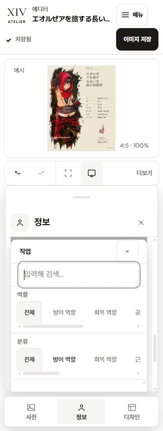

# 전체 UI·UX 및 접근성 비판적 검수

2026-10-12. **현재 전체 준수 상태는 아니다.** 설치된 Stone 테마 원본은 유지됐지만, 실제 토큰 사용 위치의 대비와 모바일 선택창 배치에 결함이 있다. 이번 요청은 검수이므로 제품 코드나 디자인 계약을 수정하지 않았다.

## 기준과 실제 실행 범위

- 앱 UI 기준: 루트 `DESIGN.md`. 카드 작품은 V3 계약을 따른다. 예전 앱 팔레트·Figma 제안을 현행 Stone 기준보다 우선하지 않았다.
- 접근성: [WCAG 2.2](https://www.w3.org/TR/WCAG22/)의 AA 관련 기준과 실제 키보드 동작을 대조했다. 앱의 44px 목표와 [AA의 24px 최소 크기 및 예외](https://www.w3.org/WAI/WCAG22/Understanding/target-size-minimum.html)를 구분했다.
- 별도 QA origin `127.0.0.1:4324`에서 검수했다. 사용자 origin `4322`의 편집 데이터는 변경하지 않았다.
- 편집기: 사진·정보·디자인 × KO/EN/JA × light/dark × 1440/390/320px = **54조건**. 접힌 세부 항목을 모두 펼쳐 측정했다.
- 홈·템플릿·사진 시작·출력: 4경로 × KO/EN/JA × light/dark × 1440/320px = **48조건**.
- 별도 상태: 검색 팝업, 키보드 포커스, 다중 선택 제한, B/C 탭 재진입, 보관함 이름 변경 취소·닫기, 모바일 메뉴를 확인했다. 총 **117개 DOM 측정 기록**이다.
- 102개 화면 조건에서 문서 가로 넘침과 끊어진 ARIA 참조는 발견되지 않았다. 이것은 개별 팝업 잘림이나 WCAG 전체 합격을 뜻하지 않는다.
- 서체: 일본어 이름으로 3마스터 × 5프리셋을 직접 선택해 제목과 선택지 샘플의 computed family/weight를 비교했다. 모든 이름·모든 데이터 조합을 전수 선택한 검사는 아니다.

## 최우선 수정 목록

| 순서 | 위치 | 확인된 문제 | 분류와 근거 | 수정 방향 |
| --- | --- | --- | --- | --- |
| 1 | 정보 · 모바일 검색 선택창 | 직업 선택창이 도구 시트의 가시 영역보다 커서 잘린다. 키보드 활성 옵션도 화면 밖에 놓인다. | **P1 · 실제 UI 결함.** 320×844에서 선택창 약 490px, 시트 405px. 활성 바이퍼 옵션 y=906. 390px에서도 선택창 높이가 시트를 초과한다. | 선택창을 clipping/transform 경계 밖으로 옮기거나 시트 내부의 가시 높이로 제한한다. 검색·목록·닫기를 함께 보이게 하고 Tab/Escape 복귀를 재검수한다. |
| 2 | 밝은 테마 · 설명 글자 | 업로드 형식/용량, 비율 힌트, 효과 설명 등의 12px 일반 텍스트가 연한 muted 표면에서 **4.408:1**이다. | **P1 · WCAG AA 1.4.3 미달.** 일반 텍스트 기준 4.5:1. 편집기 light 행렬에서 같은 색 조합 45개 인스턴스, 사진 시작에서도 확인. | 원본 테마는 보존하고 작은 글자의 역할을 기존 foreground로 바꾸거나 충분한 대비의 기존 표면에 배치한다. |
| 3 | 밝은 테마 · 키보드 포커스 | 글꼴 펼침 제목의 저작자 지정 2px 포커스 선이 흰 표면과 **2.590:1**이다. | **P1 · WCAG AA 1.4.11 미달.** summary에는 텍스트 입력 caret 등의 대체 포커스 표시가 없다. 어두운 표면의 같은 토큰은 3.639:1. | ring 원본은 유지하면서 기존 foreground 등으로 충분한 대비의 포커스 형태를 추가한다. 관련 조작부를 함께 재측정한다. |
| 4 | 사진·정보·디자인 · 펼침 제목 | Space가 캔버스 이동 단축키에 소비돼 펼침/접힘이 되지 않는다. Enter는 동작한다. | **P2 · 표준 키보드 동작/사용성 결함.** 실제 글꼴 summary에서 재현. Enter 경로가 있으므로 WCAG 2.1.1의 전체 키보드 조작 불가로 판정하지 않았다. | summary를 캔버스 단축키 제외 대상에 넣고 모든 disclosure를 Space/Enter로 재검수한다. |
| 5 | 디자인 · 글꼴 | 선택지 샘플은 serif/sans로 바뀌지만 A 마스터의 실제 제목 family는 선택에 따라 바뀌지 않는다. | **P2 · 선택지와 결과의 의미 불일치.** 일본어 15회 선택에서 Cinematic/Editorial은 serif, Identity는 sans를 유지했다. 마스터 고정 조판 자체는 카드 계약에 맞지만 현재 ‘글꼴’ 선택지가 적용 범위를 과장한다. | 실제 지원 범위와 샘플을 일치시킨다. 제목 글꼴 변경 기능을 제공하려면 별도 렌더/출력 검증을 포함해 구현한다. |
| 6 | 디자인 · B/C 레이아웃 | B/C 선택 후 다른 탭에 갔다 돌아오면 마스터 버튼 3개 모두 unpressed, 실험 항목도 접혀 활성 표시가 숨는다. | **P2 · 선택 상태 발견성 결함.** 데이터와 렌더는 유지된다. | 현재 마스터와 변형을 보이는 영역에 명시하고 선택 상태 의미를 정리한다. |
| 7 | 정보 · 지역 필터 | 서비스·지역·DC를 ‘필터’로 표시하지만 조작하면 카드 위치 정보와 월드를 변경/초기화한다. | **P2 · 레이블/기대 동작 불일치.** 소스에서 선택 patch와 의존 값 초기화를 확인했다. 한국 서비스에서 비활성 지역에 대한 설명도 부족하다. | 실제 위치 설정임을 드러내는 레이블과 필요한 짧은 안내를 사용한다. 한국 서비스의 지역/DC 비활성을 함께 설명한다. |
| 8 | 사진 · 데스크톱 슬라이더 | 조절 range가 높이 **24px**, 헤더 한국어 홈 링크는 폭 약 35px이다. | **P2 · 앱 44px 목표 편차.** AA 24px 최소 크기 위반으로 단정하지 않았다. 모바일 사진 range는 44px이고 숫자 입력 대안도 있다. | 데스크톱 range 조작 영역과 작은 메뉴 링크를 44px 목표에 맞춰 확대한다. |
| 9 | 캔버스 상태 라벨 | `backdrop-filter: blur(12px)`를 사용한다. | **P2 · DESIGN.md §2 편차.** 불투명한 앱 상태 표면의 장식 blur이며 사진 가독성 scrim이 아니다. | 불필요한 blur를 제거한다. |
| 10 | 보관함 · 읽기 실패 | 최초 목록 읽기가 실패하면 오류와 ‘저장된 카드 없음’이 함께 표시될 수 있다. | **P2 · 소스에서 확인한 오류 상태 모순.** 실패를 실제 브라우저에 주입하지는 않았다. 데이터 손실/WCAG 위반은 확인되지 않았다. | 읽기에 성공한 경우에만 빈 목록 안내를 표시하고 오류 때는 재시도 상태를 유지한다. |

대비 판정의 근거는 [텍스트 대비 1.4.3](https://www.w3.org/WAI/WCAG22/Understanding/contrast-minimum.html)과 [포커스·비텍스트 대비 1.4.11](https://www.w3.org/WAI/WCAG22/Understanding/non-text-contrast.html)다. 원본 토큰을 설치했다는 사실만으로 실제 컴포넌트의 대비 충족을 보장하지 않는다.

## 탭별 세부 항목 검수표

| 탭 | 전체 항목/옵션 | 확인 결과 |
| --- | --- | --- |
| 사진 | JPG/PNG/WebP 업로드, 24MB 안내, 초기화, 가로/세로 0–100%, 확대 0.75–2.50× | 버튼·슬라이더·숫자 입력의 이름과 키보드 경로 존재. 가로 위치 ArrowRight/Left 변경·복구 확인. 데스크톱 range 크기와 밝은 안내 대비는 수정 필요. |
| 사진 · 세부 | 회전 −10…10°, 밝기/대비 0.5…1.5, 채도 0…1.5, 노출 −2…2 EV | 항목별 range/숫자 입력 이름과 범위 확인. summary Space 결함. 숫자 입력의 원시값과 슬라이더의 %/EV 음성 표현을 통일하는 것은 추가 개선 권고. |
| 정보 · 기본 | 이름 48자 cap, 직업 34개, 레벨 1–100, 월드 90개, 종족 8개, 종족별 부족 16개, 자유부대 48자 cap | 이름/레이블/범위와 검색 registry를 소스 대조. 검색기의 ArrowDown/Escape, active-descendant 참조, 검색 결과 없음 상태를 실제 확인. 모바일 팝업 배치는 실패. |
| 정보 · 직업 검색 | 역할 5종 + 전체, 분류 8종 + 전체, 로컬 이름/별칭 검색 | 상태와 이름이 있음. 최초 제안 목록 14개는 전체 직업 누락이 아니라 검색 제안 cap이다. 모바일 목록 잘림과 구분해야 한다. |
| 정보 · 월드 | 서비스 2종, 물리 지역 4종 + 전체, 글로벌 DC 11개 + 전체 | 선택 시 서비스/지역/DC/world 의존값 변경을 소스 확인. 필터 레이블과 데이터 변경 의미가 불일치. 한국 서비스의 지역/DC 비활성 설명 개선 필요. |
| 정보 · 상세 | 총사령부 3종, 언어 6종/최대 4, 플레이 스타일 17종/최대 5, 소개 120자 cap | 실제 최대 선택 상태에서 나머지는 disabled, 선택된 항목은 제거 가능. 원래 선택으로 복구했다. 상세 summary Space 결함. |
| 디자인 · 스타일 | 마스터 3종, 비율 5종, A 카드 문구 4종 | 선택/pressed/native radio 이름 존재. A 기본 선택 표시는 정상. B/C 재진입 상태 표시에는 결함. |
| 디자인 · 서체 | 프리셋 5종, EN/KO/JA 샘플 15종 | 일반 설정으로 분리돼 있고 중복 화살표 없음. 샘플과 실제 A 제목 서체의 불일치는 별도 UX 결함. |
| 디자인 · 색상 | 자동/사용자 지정/직업 3모드, 팔레트 4채널, 직업 문양 표시/색상/포인트 색상 복귀 | 원형 swatch 22×22px 수정은 유지됨. 색상 입력은 이름 있는 native color input. swatch는 비조작 표시이므로 44px 버튼 기준을 적용하지 않았다. |
| 디자인 · 효과 | 필름 입자/홀로그램 2종, 실험 B/C 2종 | 선택 상태와 이름 존재. 일부 밝은 효과 설명의 대비, summary Space, 숨은 B/C 선택 표시 수정 필요. |
| 공통 편집 도구 | undo/redo, 안전 영역, 미리보기, 캔버스 맞춤, 확대/축소, pan, 초기화, 보관함, 내보내기 | 이름 있는 버튼과 대체 경로 존재. 하단 toolbar는 각 버튼 Tab 접근이 가능하나 화살표 로빙 규칙의 일관성은 추가 권고. |

## 다른 화면·공통 UI

| 화면/흐름 | 실제 확인 및 소스 검토 | 남은 사항 |
| --- | --- | --- |
| 헤더·모바일 메뉴 | 이름 있는 navigation, 현재 경로, theme/locale 선택, 메뉴 Enter 열기·Escape 닫기 및 포커스 복귀 확인 | 작은 한국어 홈 링크의 앱 44px 목표 편차. 정보 선택기의 `⌄`와 native select 등은 디자인 패널 chevron과 아직 다르며 시각 일관성 권고. |
| 홈 | 스타일 pressed/check, 제작·재개·보관 흐름과 1440/320px 언어/테마 조합 | 전역 포커스 토큰의 밝은 대비를 관련 조작부에서도 후속 확인해야 한다. |
| 템플릿 | 스타일 선택, 예시/내 카드 비교 상태, CTA와 단일 주요 행동 소스 검토, 반응형 확인 | 초안이 없을 때 비활성 ‘내 카드’의 이유를 해당 선택지에 연결하는 것은 추가 권고. 이번 QA에는 초안이 있어 빈 초안 상태는 실제 재현하지 않았다. |
| 사진 시작 | 파일 선택 버튼·지원 형식·상태/오류·덮어쓰기 확인 경로 소스 검토, 화면 조합 확인 | 밝은 보조 안내 대비 수정 필요. 손상 파일/저장 오류를 이번 검수에서 새로 주입하지 않았다. |
| 출력 | PNG/WebP, 1/2/4×, 비율 5종, 실제 치수 표시, 카드 정보, 다운로드/브라우저 인쇄, 복귀·오류/재시도 경로 | 현재 요청에서 새 파일 다운로드나 OS 인쇄창을 실행하지 않았다. 출력 파일 품질의 근거는 별도 기존 출력 검수 문서다. |
| 보관함 | native 이름 있는 modal, 이름 변경 초점·취소 후 버튼 복귀, 320px 넘침 없음, Escape 닫기 후 ‘내 프로젝트’ 복귀 확인 | 읽기 오류/빈 상태 모순. 반복되는 미리보기·이름 변경·복사·삭제의 접근성 이름에 대상 프로젝트명을 포함하는 것은 추가 권고. |

## 디자인 계약과 접근성의 구분

- 테마 원본 SHA-256은 `E25912D9A98152C90EC17352DBE22A6573928522063C807DDD3CCDA906C55F92`로 일치한다. 의미 별칭과 6/8/10/14/18px 반경 체계도 일치한다. 원형 thumb·swatch·비율 도형은 기능 기하 예외다.
- UI 제목 18px, 레이블 13px, 일반 보조 레이블 12px의 활성 규칙은 일치한다. 로고 글자·aria-hidden 장식 기호를 작은 조작 레이블로 오판하지 않았다.
- reduced-motion/forced-colors 소스 규칙은 존재한다. **OS 설정을 실제 켠 환경에서 이번에 실행한 검사는 아니다.**
- 입력 경계 대비는 밝게 약 1.26:1, 어둡게 약 1.58:1이다. 경계가 입력임을 식별하는 필수 단서인지 개별 판정이 필요하므로 모든 입력을 AA 실패로 일괄 처리하지 않았다.
- CSS에 후단의 높은 specificity V3 override 층이 남아 있다. `DESIGN.md` §8의 활성 규칙 통합 요구와 다르다. 유지보수 편차이며 렌더 오류 자체의 증거는 아니다.
- 정보 섹션의 접근성 region 이름/보이는 heading 차이, 숫자 입력 단위, 보관함 반복 버튼의 대상명은 낮은 우선순위의 일관성·사용성 권고다.

## 계산·증거·한계

CSS `lab()`의 D50 값을 XYZ로 변환하고 Bradford D65 적응 후 sRGB 상대 휘도로 계산했다. [W3C CSS Color 4 변환 절차](https://www.w3.org/TR/css-color-4/#color-conversion-code)를 적용했으며 흰색 휘도 1, 검정 0을 별도로 검증했다. 초기 근사값 4.37 대신 독립 재계산된 **4.4081488759**를 최종값으로 사용한다. 비활성 컨트롤과 전환 중 opacity 표본은 확정 대비 판정에서 제외했다.

- [대비 재계산 결과](./product-previews/ui-audit-2026-10-12/contrast-verification.json)
- [3마스터 × 5서체 실제 대조](./product-previews/ui-audit-2026-10-12/font-effects-ja.json)
- 원본 DOM: `tmp/editor-full-audit-2026-10-12/ui-records.json`
- 독립 소스 검토: 같은 폴더의 `semantics.md`, `design-source.md`, `crossroute-source.md`
- 이번에 실행하지 않은 범위: NVDA/VoiceOver 등 실제 스크린리더 음성, OS forced-colors/reduced-motion, 실제 모바일 소프트 키보드, 브라우저 200% 확대·텍스트 간격 강제 변경, 저장/네트워크 실패 주입. 따라서 WCAG 전체 인증이나 전체 합격으로 표현하지 않는다.
- 프로젝트가 참조하는 portable brain/`skills/design-md/SKILL.md`는 현재 체크아웃에 없었다. 명시적인 `DESIGN.md`와 V3 문서를 직접 적용했고 가짜 memory 갱신이나 스킬 실행 기록을 만들지 않았다.

제품 코드를 바꾸지 않은 검수이므로 빌드·단위 테스트를 새로 실행한 결과를 주장하지 않는다. 다음 수정에서는 **모바일 선택창 → 텍스트/포커스 대비 → Space 동작 → 글꼴/선택 상태 → 레이블·밀도·CSS 정리** 순서로 한 항목씩 수정·실물·독립 검토 후 진행한다.

