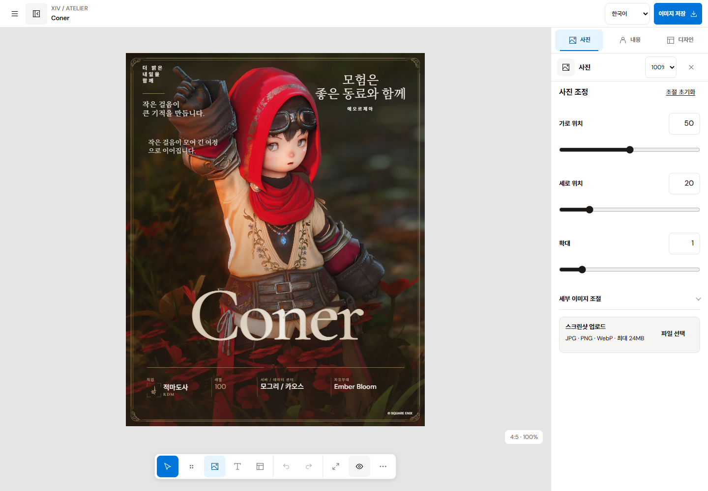
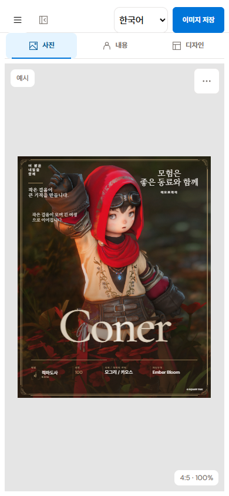
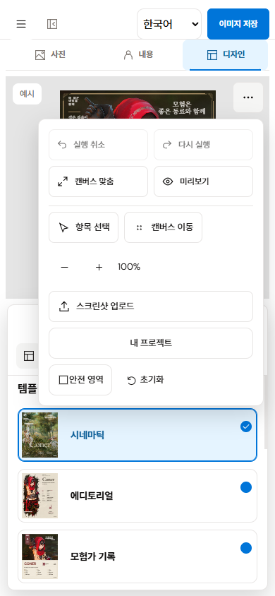

# 탐색 접기·언어 선택·모바일 도구 구성 교정

사용자 피드백에 따라 헤더와 레일 아래의 중복 접기 조작, 접힌 레일의 잔여 공간, 숨겨진 언어 선택, 모바일 하단 도크와 도구 줄을 교정했다.

- 패널 열기/접기는 모든 폭에서 헤더의 `editor-header-panel-toggle` 하나로 제공한다. 레일 아래와 모바일 하단에 있던 별도 버튼은 제거했다.
- 데스크톱에서 접으면 레일과 레이어 패널을 함께 숨긴다. 캔버스는 x=0부터 사용하며 헤더 버튼 위치는 바뀌지 않는다.
- 901–1180px에서는 레일을 표시하지 않고, 같은 헤더 버튼으로 레이어 서랍을 연다. Escape·Tab·배경 inert·호출 버튼 포커스 복귀를 유지한다.
- 언어 선택은 헤더 우측에 직접 표시한다. 편집기의 저장 완료/진행 문구는 시각적으로 제거하고 접근성 알림을 유지한다. 저장 오류의 복구 안내는 표시한다. 320px에서는 문서 이름보다 두 헤더 버튼·언어·이미지 저장을 우선한다.
- 모바일 작업 전환은 헤더 아래의 사진·내용·디자인 줄 하나다. 현재 작업의 선택 상태와 시트의 열림 상태를 각각 `aria-pressed`와 `aria-expanded`로 구분한다.
- 하단 도크와 하단 캔버스 도구 줄은 없앴다. 보조 캔버스 작업은 카드 영역 상단 우측의 44px 추가 도구 버튼에 모았다. 메뉴에서 실행 취소/다시 실행·맞춤·미리보기·선택/이동·확대·업로드·보관·안전영역·초기화에 접근한다.
- 데스크톱 속성 패널에도 사진·내용·디자인 탭을 제공해 왼쪽 패널이 접힌 상태에서 작업을 바꿀 수 있다.
- 모바일 시트는 기존 60px 하단 예약을 없애고 안전 영역까지 사용한다. 키보드 입력 중 작업 줄을 숨기며 폰트 검색 팝업도 같은 입력 모드에 포함한다.

모바일 도구 줄이 다시 나타나던 원인은 후반의 `.page .toolbarPrimary { display:flex }`가 앞의 모바일 숨김 선언을 덮는 CSS 순서였다. 기본 규칙을 모바일 분기 앞으로 옮겨 실제로 숨겨지게 했으며, 추가 도구 컨테이너를 44×44px로 제한했다.

현재 기준은 [DESIGN.md](../../../DESIGN.md) §5.1이다.

## 검증

TypeScript·전체 ESLint·프로덕션 빌드와 회귀 테스트가 통과했다. 테스트는 402개 중 **373개 통과 / 기존 렌더 아카이브 29개 건너뜀 / 실패 0개**다.

별도 Chrome 154 프로필과 로컬 검수 origin에서 **59개 브라우저 검사가 모두 통과**했다. 320/390/600/900/901/1024/1180/1181/1440/1920px와 844×390을 확인했다. 단일 버튼, 접힌 왼쪽 영역의 0px 점유, 고정된 헤더 버튼 위치, 한국어·영어·일본어의 실제 화면 전환, 저장 문구의 비시각 상태, 모바일 상단 전환·44px 추가 도구, 서랍 Tab/Escape/inert/포커스 복귀를 포함한다.

390×844에서 추가 도구 메뉴의 모든 행이 기본 높이 안에 보였다. 390×390에서는 각 버튼을 스크롤로 드러낸 뒤 중앙 좌표의 `elementFromPoint`로 실제 클릭 가능성을 확인했다. 320×390의 글꼴 검색은 검색어·포커스를 유지하고 상단 작업 줄을 숨긴 입력 모드로 전환됐으며 가로 넘침이 없었다.

검수용 4333 서버와 9350 Chrome만 정리했다. 기존 4328 주소가 응답하지 않아 현재 검증 빌드의 정적 미리보기를 그 주소에 다시 실행했고 `/editor`의 HTTP 200을 확인했다. 사용자 저장 데이터는 검수에 사용하거나 변경하지 않았다.

