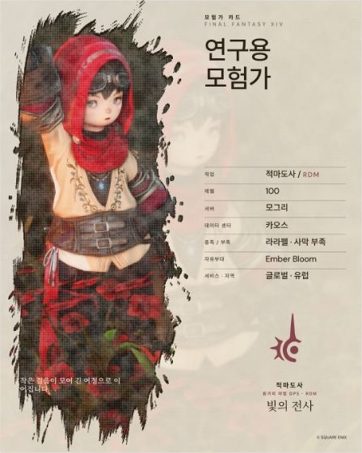

# 사진 기반 인쇄 효과 · 전체 배경

**후속 조정:** 격자 노출과 원본 사진 손상을 줄인 현재 표현은 [촘촘한 인쇄 질감 조정](SUBTLE_PHOTO_PRINT_2026-10-12.md)을 따른다. 아래 수치와 샘플은 전체 배경 도입 당시의 검증 기록이다.

2026-10-12 사용자가 제시한 제록스·하프톤·디스트레스 이미지와 전체 배경 적용 요청에 따른 수정이다. 카드 위의 일정한 점·흠집을 덮던 첫 구현은 현재 표현으로 대체했다.

## 표현

- 제록스: 원본의 색과 농담을 따라 대비, 토너의 불균일함, 잉크 끊김을 만든다.
- 하프톤: 사진의 국소 색을 샘플링하고 잉크 밀도에 따라 망점 크기를 바꾼다. 강도 100%에서 망점 사이에는 실제 종이색이 드러난다.
- 디스트레스: 사진 속 잉크와 윤곽을 따라 불규칙하게 벗겨진 부분을 만든다. 밝은 노란색처럼 명도가 높은 유색 잉크도 처리한다.

강도는 원본과 각 처리 결과의 혼합 비율이다. 순서는 제록스 → 하프톤 → 디스트레스이며 각 효과를 독립적으로 끄거나 중첩할 수 있다. 기존 필름 입자·홀로그램 선택은 유지한다. 사진의 투명 영역과 원본 파일은 보존하고, 새 무늬를 카드 정보 글자 위에 추가하지 않는다.

## 에디토리얼 배경

처리된 같은 사진을 카드 전체의 별도 배경으로 사용한다. 배경 레이어와 사진 컨테이너는 모두 `inset: 0`이며 전면 사진 패널의 너비·높이·브러시 clip을 상속하지 않는다. `object-fit: cover`로 비율을 유지하면서 카드 전체를 채운다.

1:1, 4:5, 3:4, 16:9, 9:16에서 같은 규칙을 사용한다. 9:16의 배경을 상단 42%에 제한하던 규칙을 제거했다. 배경은 16% 불투명도와 약한 blur, 전체 카드에 걸친 방사형 종이 veil로 처리한다. 정보 열을 기준으로 끊는 선형 cutoff와 배경용 마스크는 없다. 전면 사진의 브러시 경계와 기존 구도는 유지한다.

## 처리·저장 경계

사진의 픽셀 계산과 PNG 인코딩은 한 개의 module Worker에서 수행한다. 원본은 최대 변 4,096px·9MP 범위에서 처리하며 3,840×2,160과 2,160×3,840은 축소하지 않는다. 이보다 큰 사진은 처리용 복사본의 해상도를 제한하며 원본 저장 파일을 바꾸지 않는다.

완료한 Blob은 최대 6개·24MiB로 캐시한다. 처리 중 작업은 하나이고 대기열은 픽셀 버퍼가 없는 메타데이터 8개로 제한한다. 같은 사진·강도·종이색 요청은 공유한다. 필요가 없어진 대기 작업을 취소하고, 소비자가 없는 오래된 결과는 캐시하지 않는다.

0% 또는 꺼진 효과는 원본 사진을 사용한다. 처리된 이미지가 준비되면 원본 fallback을 숨겨 투명 PNG가 두 번 합성되지 않도록 한다. 내보내기는 현재 효과 키·종이색·이미지 디코딩이 준비될 때까지 기다린다. 실패·시간 초과는 실제 오류로 표시하며 원본 fallback을 성공한 처리 결과처럼 저장하지 않는다. 기존 B/C 데이터의 사진 경로도 같은 처리를 사용한다.

실제 종이색은 렌더된 카드의 `--craft-paper` 또는 `--card-light`를 읽어 해석한다. 저장된 palette.light만 사용해 마모·망점 틈의 색이 카드 바탕과 어긋나는 문제를 피한다. 앱의 Stone 테마와 서체 설정, 저장 스키마와 원본 사진 조절 값은 변경하지 않았다.

Turbopack의 Worker 추적 파일이 배포 폴더에 포함되므로 `tsconfig.json`의 소스 검사 대상에서 `out/**`, `dist/**`를 제외했다. 실제 `src` Worker와 Next 생성 타입은 계속 검사한다.

## 검증

| 검사 | 결과 |
| --- | --- |
| 순수 픽셀 처리 | 9개 검사 통과. 투명도·원본 불변·0% 동일성, 유색 망점과 종이 틈, 흰 여백·노란 꽃·레이어 순서 확인 |
| 공유·취소·복구 | 같은 키 공유, 종이색·강도별 구분, 대기 취소, 마지막 소비자 취소, Worker 오류 후 새 요청 재시도 검사 통과 |
| 실제 Worker | 프로덕션 화면에서 처리 완료 확인. 가로 4K와 세로 4K 사진의 원본/처리 이미지 natural dimensions가 일치 |
| 배경 영역 | 다섯 비율의 카드 canvas, 배경, 사진 컨테이너 실측 크기 일치. 모든 배경의 mask-image는 none. 9:16 포함 하단까지 전체 영역 유지 |
| 경계 | 처리 완료 후 원본 fallback은 hidden, 원본/처리 이미지의 CSS transform 일치. 이전 카드 전체 점·흠집 overlay 없음 |
| 통합 검사 | 테스트 305개 통과·실패 0, 기존 아카이브 29개 skip. 전체 lint·typecheck·프로덕션 빌드 통과 |
| 실제 PNG 출력 | 각 효과 100%의 4:5 및 기본 중첩 4:5는 2,160×2,700, 기본 중첩 9:16은 2,160×3,840. 정상 다운로드 완료와 결과 이미지 디코딩 확인 |
| 실제 WebP 출력 | 기본 중첩 4:5·4배 요청은 기존 메모리 제한을 적용한 4,195×5,243. 정상 다운로드 완료와 결과 이미지 디코딩 확인 |

## 출력 화면

아래는 프로덕션 내보내기 결과 이미지의 화면 캡처다. 원본 해상도의 출력 파일 자체를 대체하지 않는다.

[9:16 하단까지 이어지는 배경](product-previews/photo-print-full-background-2026-10-12/editorial-story-background.jpg) · [제록스 100%](product-previews/photo-print-full-background-2026-10-12/xerox100.jpg) · [하프톤 100%](product-previews/photo-print-full-background-2026-10-12/halftone100.jpg) · [디스트레스 100%](product-previews/photo-print-full-background-2026-10-12/distressed100.jpg)

원시 화면과 실측은 git에서 제외된 `tmp/photo-print-2026-10-12/`에 보관한다. 별도의 렌더러 또는 임시 내보내기 훅을 추가하지 않았다. 큰 사진의 모든 강도·기기 조합이나 브라우저 FPS·전체 메모리 사용을 보증하지 않는다.
