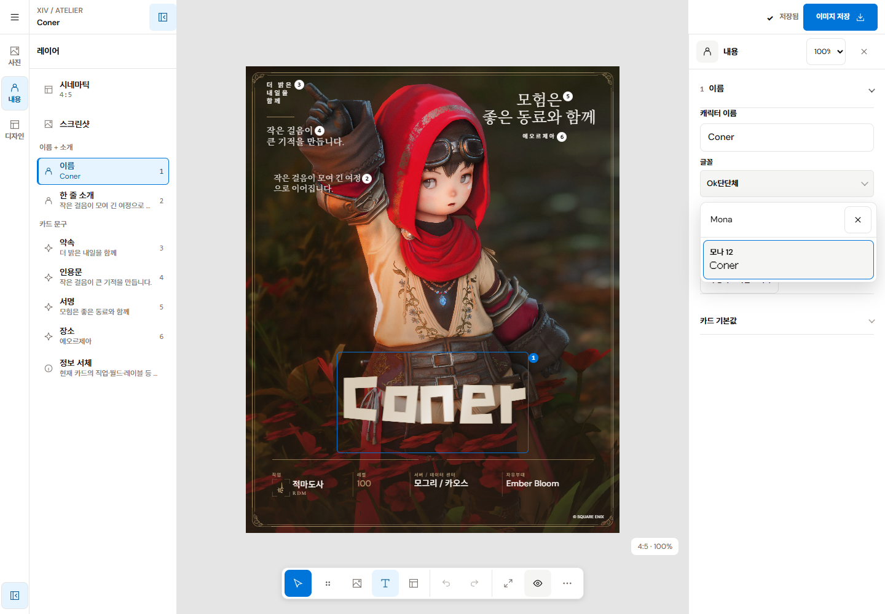
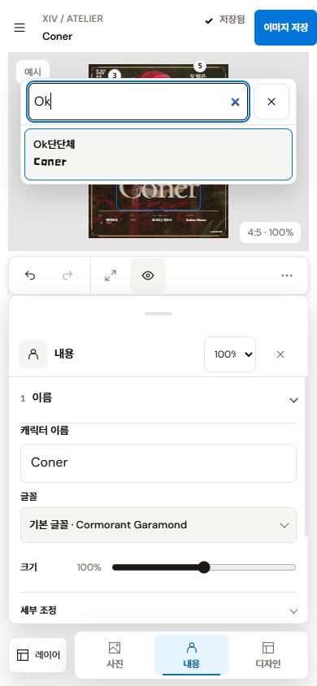

# 요청 글꼴 라이선스·문자 지원 확인과 시각적 선택기

확인일: 2026-10-13. 사용자가 제공한 13개 출처를 검토해 **16개 글꼴 계열, 34개 파일**을 추가했다. 배포처 원문, 원본 파일의 이름·굵기·cmap, 저작권과 임베딩 플래그를 함께 확인했다. 무료 사용 안내만으로 웹앱에 파일을 포함할 수 있다고 판단하지 않았다.

## 요청별 처리

| 요청 출처 | 처리 | 적용 근거·조건 |
| --- | --- | --- |
| [1. KoPubWorld](https://www.kopus.org/biz-electronic-font2/) | 보류 | 공식 안내에서 서버·앱 임베딩에 별도 승인을 요구한다. 등록·승인을 대신 수행하지 않았다. |
| [2. Pretendard](https://cactus.tistory.com/306) | **Pretendard / Pretendard JP** 추가 | [공식 v1.3.9](https://github.com/orioncactus/pretendard/tree/v1.3.9)의 OFL 1.1과 배포된 원본 variable WOFF2를 사용한다. 저작권·OFL 전문을 제공하며 RFN이 있는 파일을 수정하지 않았다. |
| [3. CHAI](https://www.artistchai.co.kr/#/pride/identity_font) | **차이 활짝체 / 차이 상승체** 추가 | 전문과 저작권을 포함한 소프트웨어 번들·재배포가 허용된다. 파일 수정이 금지되어 공식 WOFF2를 그대로 사용한다. 제작 이미지가 자료 수집·연구·마케팅에 쓰일 수 있으며 제작자에게 제외 요청이 가능하다는 조항도 전문에 보존했다. |
| [4. 마루미냐 한글](https://quiple.dev/font/maruminya-hangul) | **MaruMinya Hangul** 추가 | 제작자 [원본 WOFF2와 OFL](https://github.com/quiple/x12y12pxMaruMinyaHangul)을 사용한다. |
| [5. Ok말랑체](https://www.okticon.com/freefont/?bmode=view&idx=169969470) | 보류 | 개인·상업 사용 안내와 별도로 직접 파일 재배포가 금지된다. 이 웹앱에서 파일을 제공할 근거를 확인하지 못했다. |
| [6. Ok단단체](https://www.okticon.com/freefont/?bmode=view&idx=169969648) | **Ok Dandan** 추가 | 제작자의 2026-08-26 댓글 `c202608265cc319898ba31`이 사용자의 이미지·영상 제작용 앱 탑재를 허용한다. 이 용도에 한해 원본 `OkDanDan-Bold.ttf`를 사용하며 변환·서브셋·별도 다운로드 상품을 만들지 않았다. 파일 내부 굵기는 500이다. 제작 이미지의 마케팅 활용 조건을 고지에 기록했다. |
| [7. 온글잎 오케이티콘체](https://www.okticon.com/freefont/?bmode=view&idx=169962155) | 보류 | 해당 제작자 페이지가 직접 파일 재배포를 금지하며, 이 파일의 웹앱 제공 허용은 확인되지 않았다. 일반적인 다른 온글잎 글꼴 조건으로 이 개별 제한을 덮지 않았다. |
| [8. Ok써니노트체](https://www.okticon.com/freefont/?bmode=view&idx=169969594) | 보류 | 해당 공식 페이지의 직접 파일 재배포 금지와 별도로 웹앱 제공 허용을 확인하지 못했다. |
| [9. Monad ABXY](https://monadabxy.com/fonts/) | **모나 / 림굴 / 서궁 / 탕바 / 움돋** 추가 | 다섯 계열의 공식 12px Regular/Bold WOFF2를 포함한다. 각 OFL 1.1과 원본 저작권, 모나의 상위 프로젝트 고지도 제공한다. 다른 픽셀 크기 변형은 중복 선택지로 늘리지 않았다. |
| [10. 서울서체](https://www.seoul.go.kr/seoul/font.do) | **서울한강체 / 서울남산체 / 서울알림체** 추가 | 공식 페이지의 서체 저작권 안내 바로 아래에 표시된 [공공누리 제1유형](https://www.kogl.or.kr/info/licenseType1.do)을 적용한다. 출처·링크·변환 내역을 표시한다. 원본 글리프를 수정하거나 서브셋하지 않고 WOFF2 컨테이너로 압축했으며 cmap·글리프 순서·수평 메트릭을 대조했다. 선택한 서체의 출처 링크도 속성 패널에 표시한다. |
| [11. 온글잎 영롱](https://www.ownglyph.com/trial/30d9b1a5-8d7a-4e6d-8df6-f7a6bedfa959) | **온글잎 영롱** 추가 | [온글잎 오리지널 라이선스](https://www.ownglyph.com/font)가 웹서버 임베딩과 파일 배포를 허용한다. 수정은 금지하므로 공식 원본 WOFF2를 사용한다. 이미지의 프로모션 활용 조항도 고지에 보존했다. |
| [12. 온글잎 박다현체](https://www.ownglyph.com/trial/11ebf7f8-0997-4f03-a393-0959a07286aa) | **온글잎 박다현체** 추가 | 같은 공식 라이선스와 원본 WOFF2 경로를 적용한다. 페이지·API TTF·WOFF2의 글꼴 이름, 문자 수와 굵기가 일치한다. |
| [13. 을유1945](https://www.eulyoo.co.kr/member/font.html) | 보류 | 웹 디자인 용도와 별도로 임베딩·복제·수정·재배포가 명시적으로 금지된다. 서버에서 서체 파일을 제공하지 않았다. |

보류한 다섯 출처는 선택기에 가짜 미리보기나 비활성 글꼴로 추가하지 않았다. 각 보류는 위의 파일 제공 범위에 대한 판단이며 인쇄물·이미지 제작 등 다른 사용 범위가 전부 금지된다는 의미가 아니다.

## 실제 문자 지원

- Pretendard JP, MaruMinya Hangul, Mona 12는 한글 11,172자·라틴 문자와 검사용 일본어 문장을 원본 cmap에서 확인했다. 한·영·일 혼용 선택에 제공한다.
- Pretendard 일반형, CHAI, 림굴·서궁·탕바·움돋, 서울서체와 Ok단단체는 한글·영어 선택에 제공한다. 일부 파일에 가나나 한자가 있어도 일반 일본어 검사용 글자 `険`·`戦` 등의 누락이 확인되면 일본어 지원 목록으로 확대하지 않았다.
- 온글잎 영롱은 한글 2,350자, 박다현체는 2,780자다. 기본 라틴 문자·숫자를 포함한다. 지원하지 않는 글자는 카드의 기존 대체 서체가 표시한다.
- 표준 이름·소개·문구의 개별 선택과 작은 정보 세트의 그룹 변경, 기존 초안 복원과 undo/redo 경로를 사용한다.

배포 파일의 합계는 **30,899,628 bytes**다. 선택하지 않은 모든 글꼴을 시작할 때 내려받지 않는다. CSS 선언만 등록하고 카드에서 선택하거나 글꼴 목록에서 실제로 보이는 미리보기 행만 요청한다. 목록의 미리보기는 선택한 실제 문장을 사용하며, 로딩·오류를 구분해 대체 서체를 진짜 글꼴 미리보기처럼 표시하지 않는다.

## 출처·포맷·검증 경계

[폰트 출처 목록](../../../licenses/fonts/FONT_SOURCES.md), 각 라이선스 전문, [파일 해시·글리프 감사 자료](../../../licenses/fonts/REQUESTED_FONT_AUDIT_2026-10-13.json)를 저장했다. 고지와 원문은 `/fonts/NOTICE.txt`, `/fonts/licenses/`로 함께 배포한다. CHAI의 preview/print 임베딩 플래그와 서울서체의 기존 플래그는 원본 그대로 유지한다. 플래그 자체를 사용 허가로 판단하지 않았다.

원본 TTF/OTF 지원을 등록기와 출력 CSS 처리에 추가했다. Ok단단체는 다운로드한 원본 바이트가 출력의 `font/ttf` data URL에도 그대로 들어가는 테스트로 확인한다. 모든 신규 파일은 감사 자료의 SHA-256과 등록된 크기·공개 라이선스 사본이 일치해야 한다.

TypeScript, 전체 ESLint, 글꼴 등록기 생성/검사와 프로덕션 빌드가 통과했다. 최종 작업 공간의 통합 테스트는 **402개 중 373개 통과, 기존 렌더 아카이브 검사 29개 건너뜀, 실패 0개**다. 병행된 XXD 공통 아이콘 변경을 보존한 상태에서 확인했다.

Chrome 154의 별도 로컬 origin/프로필에서 **29/29 브라우저 검사**가 통과했다. 320/390/900/901/1024/1180/1181/1440/1920px와 844×390, 데스크톱 패널 접기·미리보기 복귀, 모바일·태블릿 서랍 포커스, 라이트/다크 선택색, 모션 감소, 보이는 글꼴 행의 지연 로드, 한글/영문 검색, 화살표·Enter·Escape, IME 조합 중 Enter, 모나 선택의 undo/redo·새로고침 복원, 일본어 마루미냐 샘플을 확인했다.

390×390의 키보드 대응 상태에서는 포털에 열린 글꼴 검색도 편집 입력으로 인식했다. 하단 도크가 숨겨지고 검색 입력은 16px이며 팝업은 보이는 화면 안에 있었다. 후속 캡처에서 텍스트 분류와 선택 항목의 배경 `#e5f4ff`, 글자 `#075b96`, 경계 `#0075d9`가 같은 역할로 계산됨을 확인했다.

`/export` 화면에서 **서울한강체 PNG**와 **원본 Ok단단체 TTF를 사용한 WebP**를 실제 생성했다. 두 결과 모두 1080×1350이며 파일 시그니처와 UI의 크기 표시가 일치했다. 사용자의 4328 미리보기와 저장 데이터는 검수에 사용하지 않았다.

최종 화면은 [검수 이미지 폴더](./product-previews/fonts-upgrade-2026-10-13/)에 보관한다.

