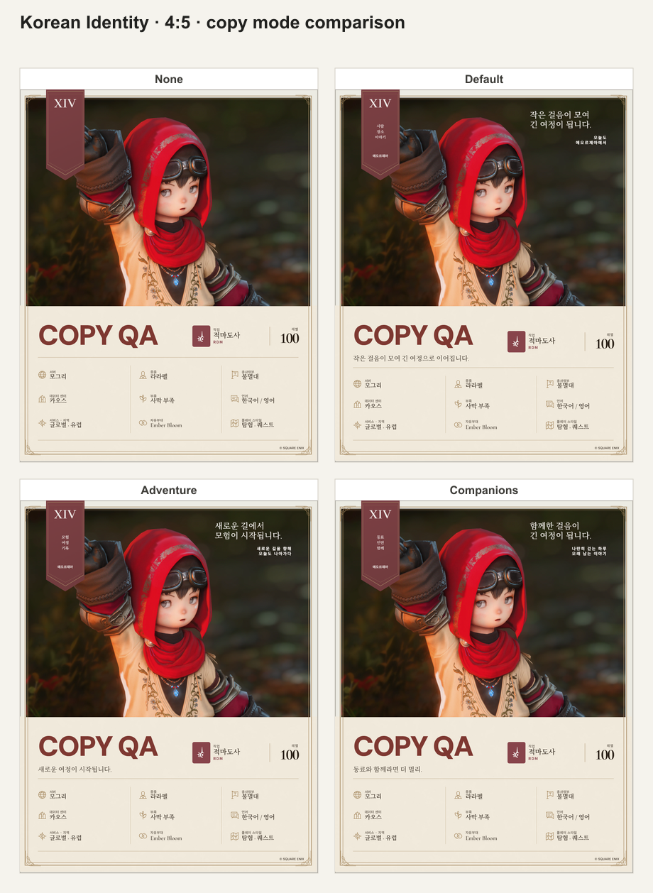
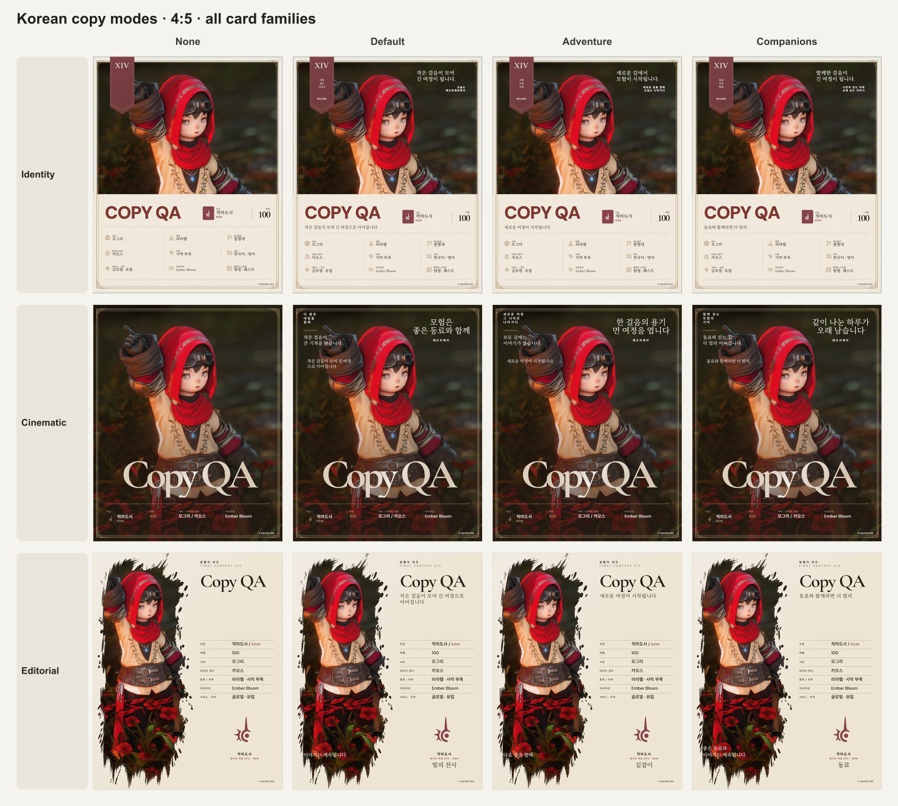
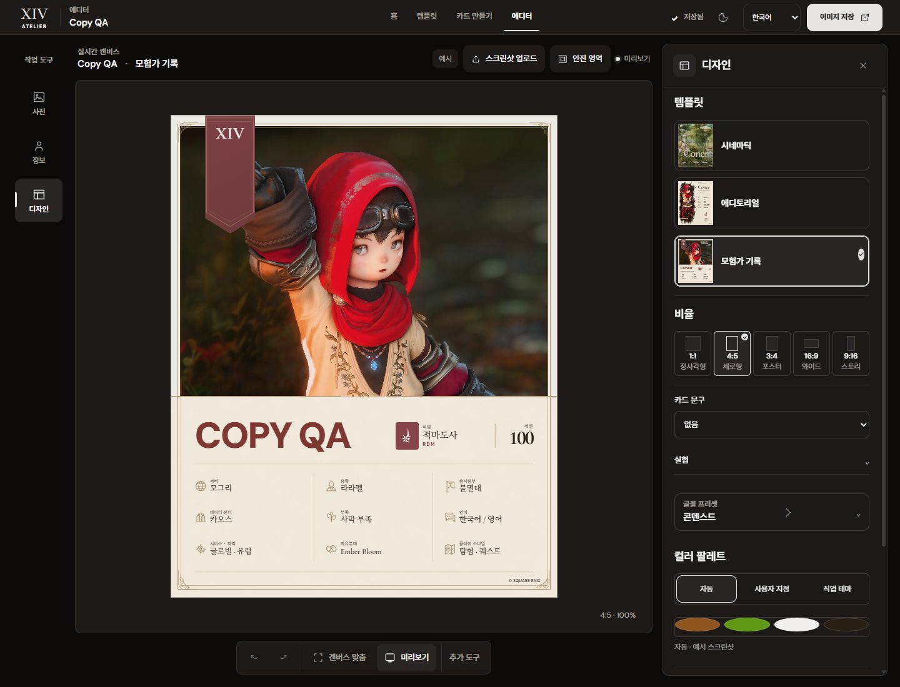
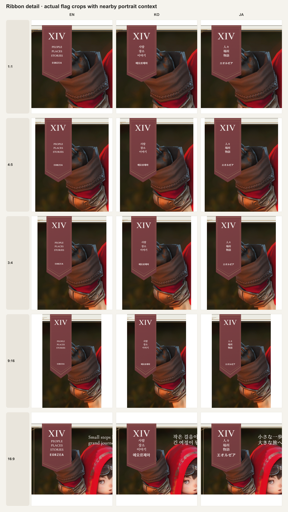

# 아이덴티티 깃발 배치·장식 문구 선택

2026-10-12 사용자가 비교 이미지의 왼쪽 깃발 글자 겹침/잘림과 고정 설명 문구를 지적했다. 깃발을 먼저 수정·빌드·실측·원본 출력·독립 검토한 후, 문구 선택 기능을 진행한다. 앱 UI는 `DESIGN.md`와 설치 Stone 테마를 따른다.

## 1. 깃발 배치 — 검증 완료

수정 전 3언어 × 5비율을 실제 화면에서 측정했다. 일반 세로형의 세 wrapper 사이에서는 DOM 겹침을 확인하지 못했지만, JA 9:16의 지역명과 16:9의 지역명/일부 영문 가운데 문구가 사선 polygon 안에 들어오지 않았다. 16:9 XIV는 실제 scrollWidth 45px가 clientWidth 40px를 넘었다. 사용자 이미지의 모든 문구가 실제로 겹쳤다고 과장하지 않고, 확인된 clip/폭 문제를 수정한다.

기존 flex 쌓기와 `margin-top:auto`를 독립된 세 grid 행으로 바꿨다. 제목·가운데 문구·지역명은 서로의 영역을 침범하지 않는다. 아래 notch 영역에 안전 여백을 확보했고, 가로형은 별도의 상단 여백·간격을 사용한다. 깃발 외곽 위치·폭·높이·polygon과 사진 구도는 유지했다.

작은 mono 표식으로 과도하게 축소한 첫 제안은 채택하지 않았다. 최종 XIV는 원래 serif family와 금빛 역할을 유지하며 일반형 4.4cqi, 가로형 3cqi, weight 600, line-height 1.1이다. 가운데 문구는 일반형 1.27cqi/가로형 1cqi, 지역명은 1.1cqi다. 일반형 아래 안전 여백 7.5cqi, 가로형 4.5cqi를 사용한다.

- 최종 15조건: 각 wrapper가 polygon 안에 있고, horizontal scroll overflow와 영역 사이 겹침 없음. scrollHeight/clientHeight의 1px 차이는 fractional layout의 정수 반올림과 구분했다.
- 최종 금빛 표식 원본 PNG 15개: KO/EN/JA × 1:1/4:5/3:4/9:16/16:9, 실제 UI에서 생성 완료. 독립 검토에서 모두 전체 decode·치수 확인, 선택한 원본의 glyph 잘림 확인을 통과했다.
- 중간 ivory 표식 KO 5개는 `ribbon-pre-preservation-runs.json`으로 분리하고 최종 15개 통과 수에서 제외했다. manifest 20개 중 현재 기록과 연결된 원본은 15개다.
- 근거: `tmp/ribbon-copy-validation-2026-10-12/ribbon-before.json`, `ribbon-after.json`, `ribbon-export-runs.json`, `ribbon-preserved-build.log`, `ribbon-independent-review.md`.

깃발 완료 판정 후에만 다음 문구 기능의 구현을 시작했다.

## 2. 장식 문구 선택 — 검증 완료

편집기 → 디자인 → **카드 문구**에서 ‘없음·기본·모험·동료’를 선택한다. 선택은 각 카드의 `design.decorativeCopy`에 저장한다. 기존 카드에서 설정이 없거나 잘못된 값이면 기존 기본 문구를 사용하며 새 개인 사진은 없음으로 시작한다. 사용자 소개·캐릭터 필드·필수 표기·출처는 보존한다. 고정된 예시 소개는 알려진 sample 이미지와 untouched sample 원문으로 식별한 경우에만 선택한 모드의 표시를 따른다. 저장된 소개 원문은 변경하지 않는다.

| 선택 대상 | 동작 |
| --- | --- |
| 시네마틱 | 위쪽 약속·인용·서명·장소 문구 선택 |
| 에디토리얼 | 사진 위 기본 이야기·장식 칭호 선택; 직접 쓴 소개 유지 |
| 아이덴티티 | 깃발 가운데·지역명·사진 위 인용·짧은 표식 선택 |
| 알려진 untouched 예시 소개 | 없음은 표시 제거, 모험·동료는 선택 문구 표시 |
| 실제 프로필/개인 소개 | 원문을 보존하고 기존 마스터·비율의 표시 규칙 유지 |

XIV/FINAL FANTASY XIV 표식, 필드 레이블, 접근성 이름과 © SQUARE ENIX 표기는 선택으로 없애지 않는다. 이 옵션은 세 canonical A 마스터에 적용하고, 실험 B/C 레이아웃은 기존 문구를 유지한다. 새 사용자 전체 기본 선호나 자유 입력 문구 라이브러리를 별도로 만들지 않았다.

### 실제 검사

- 편집기의 native select는 높이 44px, 글자 13px, token 반경 8px다. KO/EN/JA 레이블과 네 값의 선택을 실제 UI로 확인했다.
- 3 masters × 3 locales × 4 modes × 5 ratios = **180조건**을 확인했다. 표시된 장식 box는 카드 안에 있고 가로 scroll overflow가 없었다. ‘없음’에서는 장식과 untouched 예시 소개가 제거됐다. 아이덴티티 깃발은 각 선택 문구에서도 polygon 안에 있고 겹치지 않았다.
- 처음에는 기존 CSS에서 숨기는 에디토리얼 칭호의 0×0 box까지 실패로 계산했다. `copy-matrix-hidden-diagnostics.json`에 남기고 표시된 요소 기준으로 정정했다. 숨긴 요소를 새 잘림 결함으로 수정하지 않았다.
- 원본 검수에서 KO 모험 문구의 동일 문장 반복과 아이덴티티 인용의 끝 글자 `다.`가 고립되는 문제를 별도로 찾았다. 앞 문제는 `다음 장을 향해.`로 정리했고, 뒤 문제는 `새로운 길에서` / `모험이 시작됩니다.`로 줄였다. 폭 검사만으로 줄바꿈 품질을 승인하지 않았다. 수정 후 다섯 비율의 실제 원본과 각 span의 한 줄 유지(10/10)를 확인했다.
- 선택 undo → 없음, redo → 모험, 새로고침 → 모험에서 전체 카드 문구가 이전 상태와 일치했다. `QA Card Copy 2026-10-12`에 모험 상태로 저장한 뒤 기본으로 바꾸고 프로젝트를 다시 열어 모험/전체 문구 복원을 확인했다.
- 직접 쓴 `제가 직접 쓴 소개입니다.`는 없음 상태에서도 세 카드의 4:5에서 그대로 보였다. 아이덴티티에서는 새로고침 후에도 유지했다. 시네마틱 9:16/16:9의 기존 소개 숨김 CSS는 데이터 삭제와 구분했다. 테스트 후 QA 예시 원문을 복원했다.
- 일반 빌드에서 390/320px × 3 masters × 4 modes = **24개 실제 선택 조작**을 확인했다. 값 일치·44px 높이·너비 안 포함·디자인 시트 닫기가 정상이다.

### 원본 출력과 독립 검토

현재 문구 원본은 **51개**다: 세 카드·세 언어·네 선택의 4:5 PNG 1× 36개, KO 아이덴티티 줄바꿈 수정을 다른 네 비율로 확인한 4개, 좁은 구도의 긴 동료 문구 8개, WebP/배율 대표 3개다. 마지막 집합은 JA 아이덴티티 동료 WebP 4×와 EN 시네마틱 모험/KO 에디토리얼 없음 WebP 1×다.

깃발 단계의 최종 15개와 합쳐 **66/66 파일**을 독립 검사했다. 전체 Sharp decode·형식 signature·치수 계산·bytes·SHA-256·sidecar·manifest·화면 bitmap 치수가 일치했다. 4×는 실제 4195×5243, 21,994,385 pixels로 22MP/8192 edge 상한 안이다. manifest 72개 중 중간 깃발 5개와 교체한 고립 글자 원본 1개는 최종 통과 66개에서 제외했다.

검수 코드 제거 후 일반 빌드의 KO 아이덴티티 없음 PNG 1×도 1080×1350 완료, 장식/예시 소개 없음, console warning/error 없음이다. 일반 빌드·타입·전체 ESLint·전체 테스트 **265개 통과 / 기존 archive 29개 skip / 실패 0개**, 변경 파일 whitespace 검사 통과를 확인했다. src/out/dist에 QA endpoint/환경 플래그/타이머가 없고 Stone 원본 SHA-256은 `E25912D9A98152C90EC17352DBE22A6573928522063C807DDD3CCDA906C55F92`다.

근거는 같은 `tmp/ribbon-copy-validation-2026-10-12/`의 `copy-first-ui.json`, `copy-matrix.json`, `copy-ui-choices.json`, `copy-history-reload.json`, `copy-project-restore.json`, `custom-bio-4x5-preservation.json`, `quote-line-repair.json`, `mobile-copy-controls.json`, `copy-export-runs.json`, `normal-none-export.json`, `final-*.log`, `copy-final-file-audit.md/.json`, `copy-independent-review.md`다. 모든 UI 입력과 보관 테스트는 별도 4324 origin이며 사용자 4322 데이터는 변경하지 않았다.

### 범위의 한계

DOM box/scroll 수치는 glyph outline 검사가 아니다. 일부 vertical scrollHeight는 정수 clientHeight보다 1–2px 크므로 원본 시각 검사를 함께 사용했다. 세 마스터·세 언어의 없음/모험 4:5 18개와 수정·좁은 비율 대표 원본을 독립적으로 확인했다. 모든 기기·OS·font face별 glyph rasterization 또는 실제 OS 다운로드 66회를 통과했다고 주장하지 않는다. 수집한 파일은 별도 loopback collector가 앱의 생성 Blob 원본을 보관한 것이다. 새 업로드 카드 없음 기본값은 constructor/store 테스트로 확인했으며 실제 파일 선택을 다시 실행하지 않았다. Portable brain 파일과 CLI가 이 checkout에 없어 해당 시스템에 기록했다고 주장하지 않는다.

## 비교 이미지

