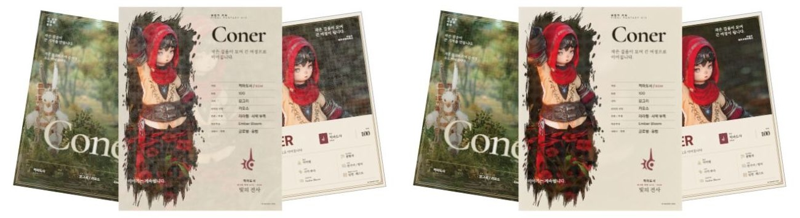
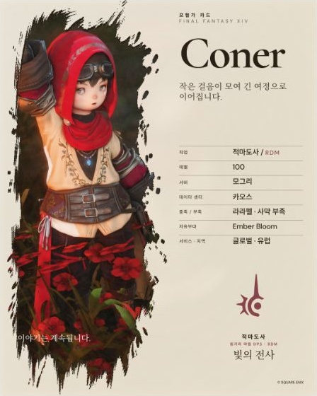

# 원본을 보존하는 촘촘한 인쇄 질감

2026-10-12 사용자가 홈 예시 카드의 격자와 원본 사진 손상을 지적한 후 조정한 기록이다. [전체 배경 적용](PHOTO_PRINT_FULL_BACKGROUND_2026-10-12.md)의 화면 샘플과 강도 표현보다 이 후속 조정을 우선한다.

## 문제와 수정 기준

세 예시 카드는 모두 하프톤을 기본 활성화했다. 기존 망점 간격은 2,160px 사진에서 약 20px여서 작은 카드에서도 사각 격자로 드러났다. 제록스·디스트레스의 넓은 농담 변화도 겹치면서 사진의 색과 디테일을 흐렸다.

원본 사진을 주인공으로 두고, 낮은 강도에서는 촘촘한 인쇄 질감이 가까이에서 보이는 정도로 처리한다. 세 효과는 계속 중첩하며 사용자의 활성화·강도 설정은 보존한다. 0%는 원본과 동일하고 높은 강도는 의도적인 인쇄 표현으로 사용할 수 있다.

망점 간격은 짧은 변 / 400으로 조정하고 일반 사진에서 2–8px로 제한한다. 2,160px 사진에서는 약 5.4px다. 강도는 낮은 구간에서 완만하게 증가하는 곡선을 적용해 기본값 22/18/15의 실제 처리 혼합이 약 10/8/6%가 된다. 100%의 인쇄 표현은 유지한다. 제록스의 넓은 토너 얼룩과 대비를 낮추고 디스트레스의 마모 크기와 손상량도 줄였다.

에디토리얼 배경은 모든 비율에서 카드 전체를 채운다. 불투명도는 16%에서 6.5%로 낮추고 blur는 .22cqi에서 1.8cqi로 늘려, 정보 뒤에 두 번째 얼굴이 선명하게 나타나는 문제를 줄였다. 전면 브러시 구도와 정보 구조는 유지한다.

## 검증

| 검사 | 결과 |
| --- | --- |
| 실제 가로·세로 4K 사진 | 같은 기본 중첩·종이색에서 세로 사진의 평균 RGB 차이 30.32 → 9.46, 가로 사진 23.16 → 7.95. 알파 변경 0. 원본 파일 불변 |
| 원본 보존 회귀 검사 | 기본 중첩의 평균 채널 오차 < 12, 유색 영역 hue 변화 < 18°, 강한 윤곽 보존 > 80%. 합성 fixture의 정량 검사이며 모든 사진에 대한 보증은 아님 |
| 망점·투명도 | 100% 유색 망점·종이색 틈·촘촘한 간격, 1×1·1×7 입력, 부분/완전 투명도와 0% 원본 동일성 확인 |
| 홈 실제 화면 | 같은 세 예시 카드에서 큰 격자 제거 확인. 처리 완료 상태에서 원본 fallback은 hidden으로 한 번만 합성 |
| 실제 PNG 저장 | 일반 UI 경로로 기본 중첩 4:5·2배 출력. 완료 상태와 결과 이미지의 2,160×2,700 디코딩 확인 |
| 통합 | 테스트 308개 통과, 실패 0, 기존 아카이브 skip 29개. 전체 lint·typecheck·프로덕션 빌드 통과. 독립 검토에서 차단 결함 없음 |

설치된 Stone 테마 SHA-256은 기존 계약과 동일하다. 사용자의 효과 선택·저장 데이터·사진 위치·배율을 바꾸지 않고 공통 픽셀 처리 표현을 수정했다.

왼쪽은 수정 전, 오른쪽은 수정 후다. 같은 예시 사진과 기본 강도로 비교했다.

[출력 완료 화면](product-previews/subtle-photo-print-2026-10-12/export-screen.jpg) · [4K 사진 측정값](product-previews/subtle-photo-print-2026-10-12/photo-retention.json). 캡처 JPG는 원본 해상도의 PNG 파일 자체가 아니다.
