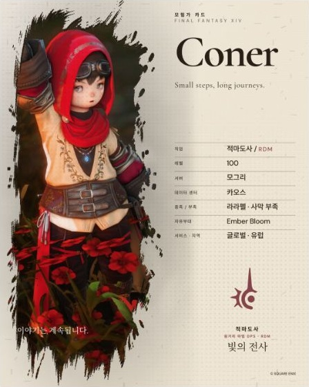

# 서체 편집 · 인쇄 질감 레이어

서체 편집은 현재도 유지한다. 효과 표현과 에디토리얼 배경의 후속 수정은 [사진 기반 인쇄와 전체 배경](./PHOTO_PRINT_FULL_BACKGROUND_2026-10-12.md)을 따른다. 아래 효과·사진 배경 검증은 해당 단계의 기록이다.

2026-10-12 사용자의 에어브러시 참고 이미지와 서체 편집·질감 추가 요청에 따른 후속 변경이다. 기존 `62db198` 이후의 로컬 변경이며 추가 푸시는 실행하지 않았다.

## 에디토리얼 경계 수정

이전 시안의 직사각형 하프톤 영역과 선형 종이색 덮개를 제거했다. 선명한 사진과 원본 브러시 clip은 유지하고, 같은 사진의 장식 복사본을 흑백 농담·blur·넓은 방사형 마스크로 처리한다. 번짐은 사진 패널의 clip과 너비 제한을 상속하지 않는다. 9:16은 상단 사진 구도에 맞게 번짐 중심과 반경을 바꾼다.

별도의 이미지 편집본을 저장하지 않는다. 사진 조절 값은 원본과 장식 복사본이 공유하며 장식 복사본은 빈 alt와 aria-hidden을 사용한다.

## 서체 편집

디자인 패널에서 이름, 소개, 직업, 정보 값, 레이블, 캡션, 짧은 문구를 각각 선택한다. 글꼴, 기본 크기 대비 비율, 실제 지원 굵기, 자간을 조절하고 선택 그룹만 초기화할 수 있다. 기존 프리셋은 기본값으로 유지한다.

추가 배포 폰트는 Estonia, Bricolage Grotesque, Valley Sans, Gmarket Sans다. 앱 조작부의 기본 서체와 Stone 테마는 변경하지 않는다. 상세 출처와 원문 사용 조건은 [폰트 출처](../../../licenses/fonts/FONT_SOURCES.md)와 `/fonts/NOTICE.txt`에 보관한다.

- Gilland: 사용자가 제공한 ZIP의 제작자·사용 허용 문구를 확인했다. 폰트 파일 재배포·웹 임베딩 권한이 명확하지 않아 배포 목록에는 포함하지 않았다.
- 빛의 계승자: [공식 조건](https://heiroflighteclipse.com2us.com/en?r=p1)이 게임 관련 프로그램의 임베딩에 권리자의 서면 동의를 요구해 포함하지 않았다.
- Gmarket Sans: 공식 배포본의 전체 라이선스를 보존한다. 제작물의 폰트 홍보 활용 및 거부 의사 전달에 관한 제6항도 원문과 안내에 포함한다.

새 카드와 기본 예시는 세 인쇄 질감을 기본 강도로 함께 쌓아 시작한다. 기존 초안의 명시적인 효과 선택은 유지한다. 서체 선택과 레이어 강도는 선택적 디자인 필드로 저장하며, 과거 데이터의 서체는 기본 표현을 계속 사용한다.

## 인쇄 질감

제록스, 하프톤, 디스트레스는 독립된 장식 레이어다. 기존 필름 입자·홀로그램을 삭제하지 않고 함께 쌓을 수 있다. 각 레이어의 켜짐과 0–100% 강도를 따로 저장하며, 껐다 켜도 설정한 강도를 유지한다.

패턴 크기는 카드 폭에 비례한다. 제록스는 불규칙한 잉크 점과 옅은 복사 농담, 하프톤은 서서히 사라지는 망점, 디스트레스는 마모와 작은 인쇄 결함을 표현한다. 장식 레이어는 포인터·키보드 입력을 가로채지 않는다.

## 검증 기록

초기 에어브러시 수정의 실제 PNG 2× 출력은 4:5 2,160×2,700, 9:16 2,160×3,840에서 정상 생성·디코딩됐다. 일반 내보내기 결과 화면의 실제 bitmap을 확인했으며 임시 렌더 분기는 추가하지 않았다.

| 검사 | 실제 실행 범위와 결과 |
| --- | --- |
| 추가 폰트 | 네 서체를 UI에서 각각 선택. 렌더된 이름의 선택 family·지원 weight, font loading과 optical-ready 완료 확인 |
| 카드 조합 | 60개 DOM 조건: 세 마스터 × 다섯 비율 × 네 텍스트/언어 조건. KO UI의 긴 영문 이름, EN UI의 긴 영문 이름, JA UI의 긴 일본어 이름, KO UI의 긴 한글 이름. 이름과 정보 값 크기 125%, 정보 값 700, 자간 조절 및 세 질감 모두 켠 상태에서 optical node의 준비·가로 넘침과 페이지 가로 넘침 확인 |
| 긴 정보 값 | 4:5 KO의 일곱 정보 행에서 확대·굵기 변경 후 값이 행 위아래를 침범하지 않는지 확인. 자유부대에는 긴 영문 값을 사용 |
| 자간 재계산 | 긴 한글 이름의 측정 완료 후 실제 letter-spacing/font-size 비율과 기본 em + 조절 em 일치 확인. 오차 0.0001em 미만 |
| 중첩·복원 | vignette·grain을 유지하며 세 질감 추가. 디스트레스 끄기 → Undo → Redo → Undo, 이후 새로고침으로 폰트·크기·질감 복원 확인 |
| 모바일 | 320×844·390×844 실제 도구 시트. 새 서체 조절의 가로 넘침 없음, 조작 영역 44×44px 이상. 최초 실측의 짧은 버튼 폭 42.75px는 min-width 44px로 수정하고 재확인 |
| 최종 출력 | 기본 질감 강도 제록스 22%·하프톤 18%·디스트레스 15%와 정보 값 Gmarket Sans를 사용한 4:5 PNG/WebP 2×. 일반 렌더 경로에서 정상 완료, 결과 bitmap 2,160×2,700 디코딩 확인 |
| 통합 검사 | 테스트 291개 통과·실패 0, 기존 아카이브 29개 skip. 전체 ESLint, typecheck, 최종 프로덕션 빌드 통과 |
| 경계 | Stone 테마 SHA `E25912D9A98152C90EC17352DBE22A6573928522063C807DDD3CCDA906C55F92` 유지. export page SHA `DA94AABCAFCA1F7A67DAEFFB726668CD530C349AB578C790585A0954613AC042` 유지. 임시 출력 훅 없음 |

60개 화면 조건은 전체 텍스트의 모든 조절 조합이나 60개 파일 다운로드를 뜻하지 않는다. 큰 글자·긴 이름·현재 레이어의 렌더와 측정 조건이며, 모든 사용자 사진·서체 조합의 가독성을 보증하지 않는다. 이번 브라우저 검수에서는 동작 줄이기·강제 색상 설정을 별도로 에뮬레이션하지 않았다. 기존 전역 접근성 처리는 유지했다.

원시 근거는 git에서 제외된 `tmp/editorial-diffusion-2026-10-12/`의 `font-proof.json`, `layout-proof.json`, `undo-proof.json`, `mobile-proof.json`, `output-proof.json`, `final-tests.txt`에 보관한다. 실제 이미지 Blob의 정상 디코딩과 화면을 확인했으며, 이 턴에서 독립 파일 헤더·바이트 검사를 했다고 주장하지 않는다.

## 화면 근거

[전체 출력 화면](./product-previews/typography-print-layers-2026-10-12/final-export.jpg) · [효과 조절](./product-previews/typography-print-layers-2026-10-12/effects-editor.jpg) · [390px 폰트 조절](./product-previews/typography-print-layers-2026-10-12/font-mobile-390.jpg)

아래는 공개 샘플로 생성한 실제 PNG 결과의 표시 영역을 캡처한 JPEG다. 원본 고해상도 PNG 자체가 아니다.

